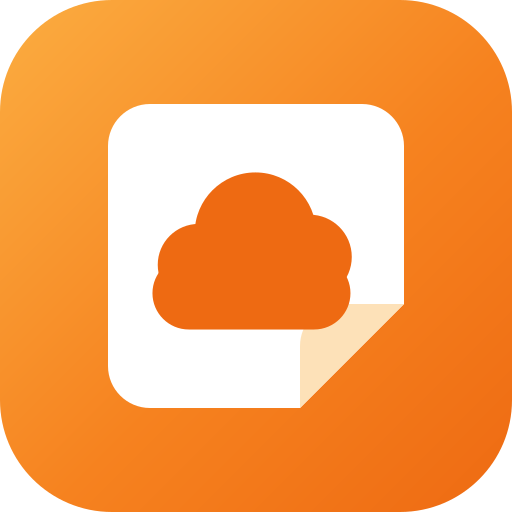
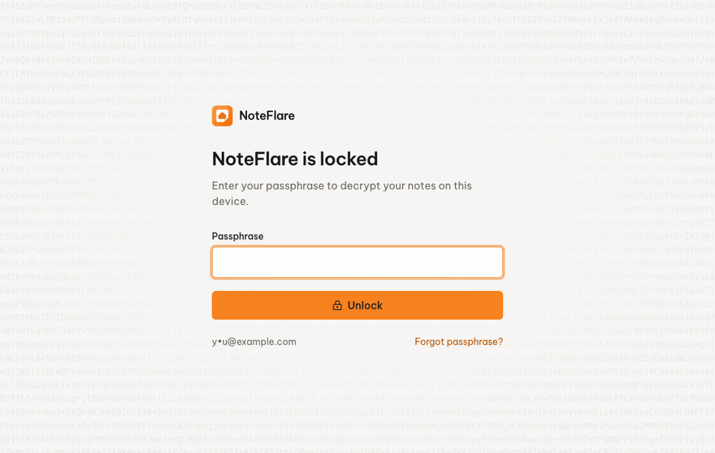
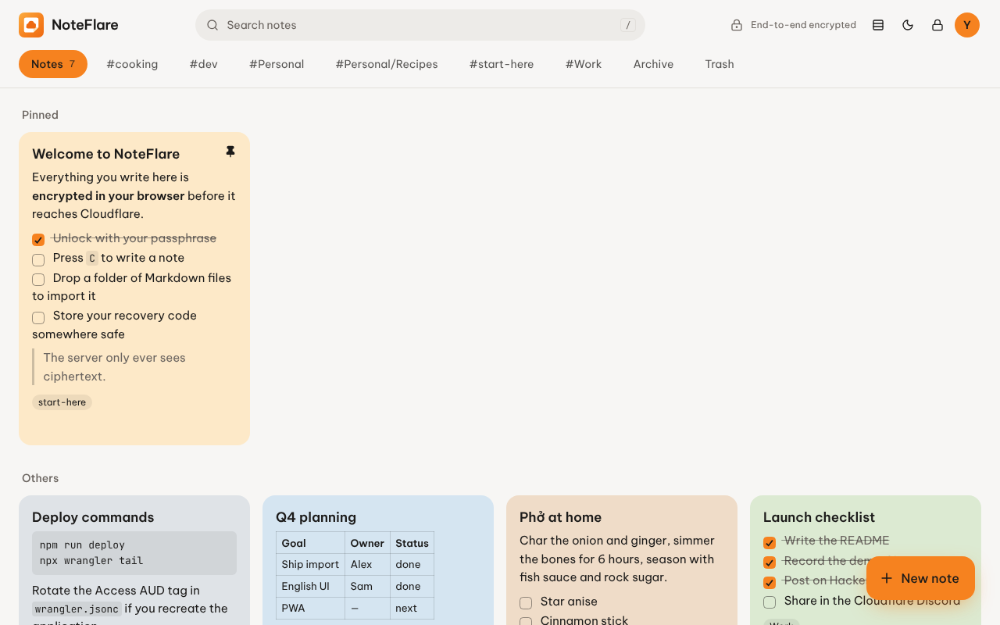
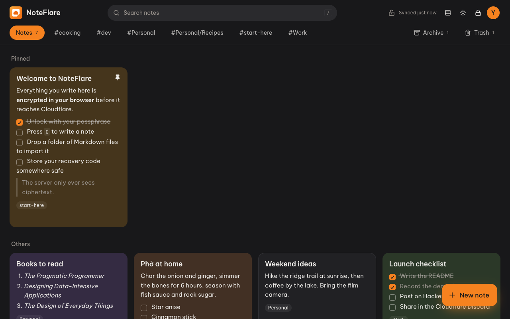
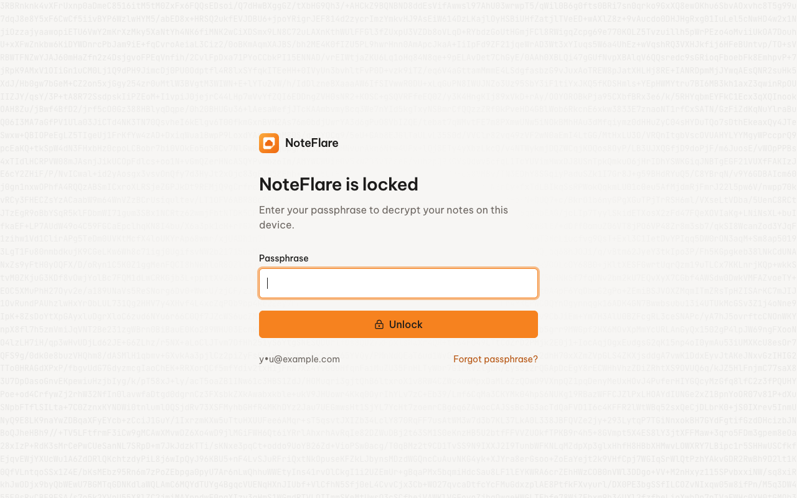
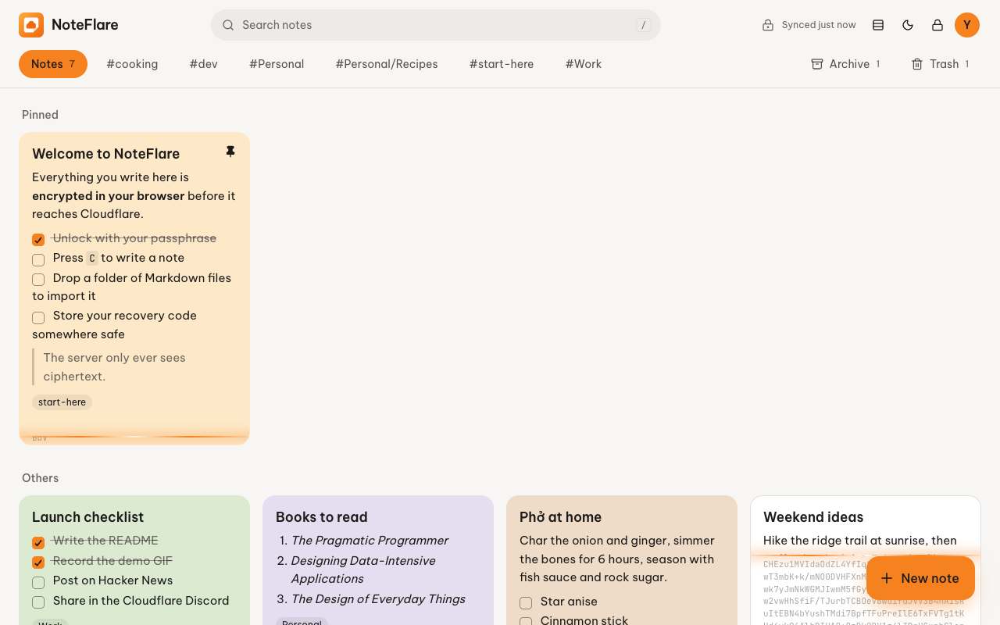
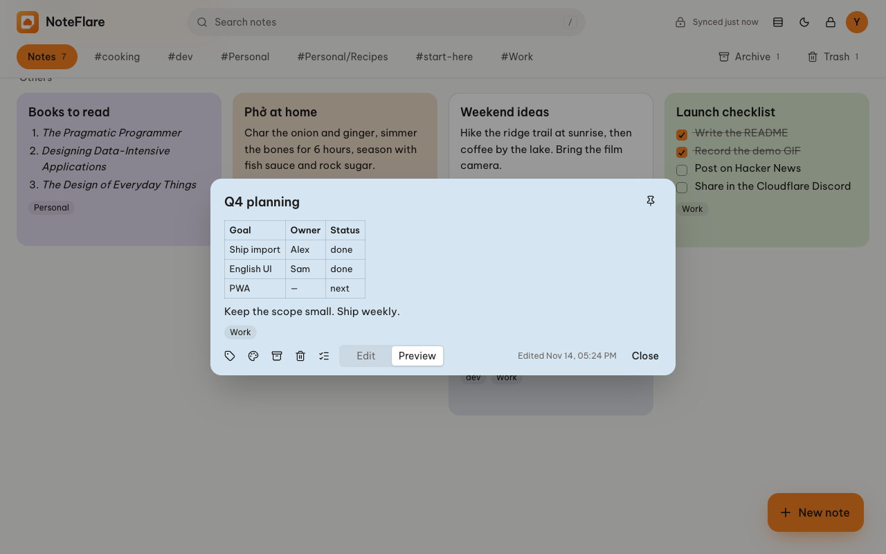
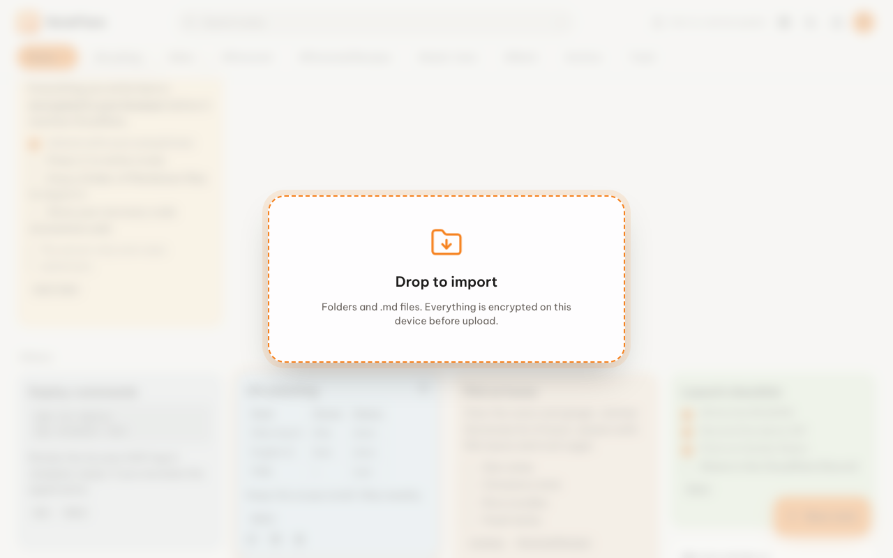
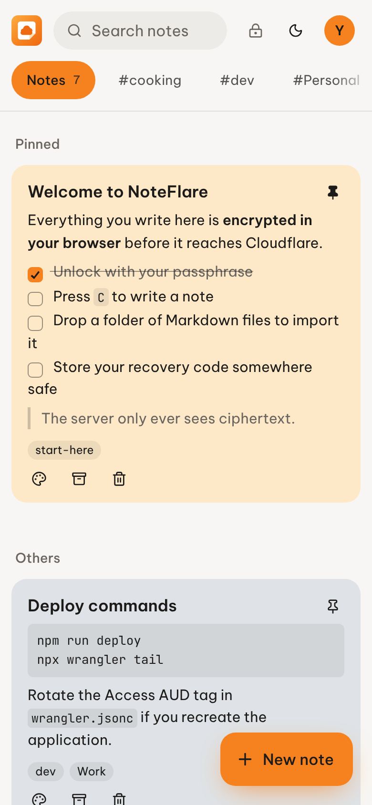
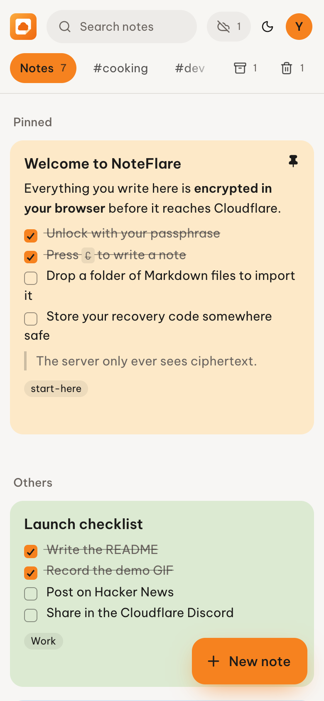

> [!WARNING]
> LOSE **BOTH** YOUR PASSPHRASE AND YOUR RECOVERY CODE AND YOUR NOTES ARE UNRECOVERABLE. THAT'S WHAT REAL END-TO-END ENCRYPTION MEANS.

<div align="center">



# NoteFlare

**Keep your notes on Cloudflare. Keep them to yourself.**

A simple, private, serverless notes app — end-to-end encrypted, completely free to run, and yours to customize.

[Documentation](https://noteflare.homielab.com) · [English](README.md) · [Tiếng Việt](README.vi.md)

[](https://deploy.workers.cloudflare.com/?url=https://github.com/homielab/noteflare)


[](https://ko-fi.com/homielab)



</div>

## ✨ Features

- 🔐 **End-to-end encryption**: Argon2id + AES-256-GCM in your browser. The server only ever stores ciphertext.
- 💸 **Completely free to run**: one Worker, one D1 database, Cloudflare Access — all on the free plan.
- 🎨 **Yours to customize**: plain React, Tailwind and shadcn/ui, a small Hono API and plain SQL migrations.
- 📝 **Markdown notes**: headings, tables, quotes, syntax-highlighted code and `- [ ]` checklists you can tick right on the card.
- 📌 **Organize your way**: pin, drag notes into the order you want, 8 paper colors, labels, archive, and a trash that empties itself after 30 days. Select several notes, or all of them, and label them or move them to the trash in one go; rename or delete a label everywhere, or make a copy of a note.
- 📥 **Drag-and-drop import**: drop a folder of Markdown (an Obsidian vault works), a Google Keep export (with its images), or an Evernote, Simplenote or Standard Notes export, and every note arrives encrypted.
- 📤 **Export and backup**: download your notes as Markdown, or as an encrypted backup you can restore later.
- 🖼️ **Encrypted images and files** (optional): attach images, PDFs or any other file, encrypted before upload and stored in your own R2 bucket. Browse every image in one gallery, with a Files tab for the rest.
- ✨ **Decrypt-in-place unlock**: watch every note resolve from ciphertext the moment you unlock.
- 📱 **Install it, use it offline**: add NoteFlare to your home screen like an app. Read, write and unlock without a connection; changes sync when you're back.
- 🔀 **Smart multi-device sync**: edits from two devices to the same note are merged line by line, like `git merge`. Only a true clash (same line, different text) becomes a separate copy.
- ⚡ **Instant updates**: an edit on one device shows up on your other open devices right away, without reloading.
- 🗝️ **Recovery code**: forget your passphrase without losing your notes, and change it without re-encrypting anything.
- 👆 **Unlock with a passkey**: Face ID, Touch ID, Windows Hello or a security key instead of typing your passphrase, still end-to-end encrypted.
- 🔗 **Share a note by link**: send a read-only copy of one note that opens without signing in. It is encrypted with a key that lives only in the link, so the server can't read it. Links can expire after 1, 7 or 30 days, and you can revoke them any time.
- 🔒 **Auto-lock**: keys are wiped from memory after 15 minutes idle or with one click.
- ✍️ **A Markdown editor that helps**: lists and checklists continue when you press Enter, Tab indents, and one tap turns lines into a checklist.
- 🌗 **Light and dark, grid or list, mobile-ready**, keyboard shortcuts (press `?` to see them) and reduced-motion support.
- 🔄 **Update notices and release notes in the app**, checked by your own Worker, with no tracking.
- 🌐 **Six languages out of the box** — English, Español, Français, Deutsch, Português (Brasil), Tiếng Việt — it follows your browser's language the first time, and adding another is one file.
- 🔌 **Build your own clients**: personal access tokens, a stable `/api/v1` with an OpenAPI spec, a TypeScript SDK that handles the encryption, and a CLI.

> [!TIP]
> **Who is NoteFlare for?** People who want the simplicity of Google Keep without handing their notes to anyone —
> including the server they run on. It's built for individuals and small groups (Cloudflare Access is free for up to 50 users).

## 🪧 Screenshots

<table>
  <tr>
    <td width="50%"></td>
    <td width="50%"></td>
  </tr>
  <tr>
    <td></td>
    <td></td>
  </tr>
  <tr>
    <td></td>
    <td></td>
  </tr>
</table>

<p align="center">
  
  &nbsp;
  
</p>

## 🚀 Get started

You need a free Cloudflare account and a free GitHub account. No coding, about 10 minutes.

1. **[Deploy in one click](https://noteflare.homielab.com/start/deploy/)**: click **Deploy to Cloudflare** above, type your email, and wait for the build.
2. **[Set up the login](https://noteflare.homielab.com/start/access/)**: open your new NoteFlare link and paste a one-time Cloudflare API token. NoteFlare adds a Cloudflare Access login so only your email can open it.
3. **[Create your passphrase](https://noteflare.homielab.com/start/first-run/)**: it encrypts your notes. Write down the recovery code.

Watch every step first: [3-minute video with narration](https://noteflare.homielab.com/start/deploy/).

Prefer a terminal, or want an AI agent to do it? See [Deploy from the command line](https://noteflare.homielab.com/start/command-line/):

```bash
bun install
bunx wrangler login
bun run deploy   # build → deploy the Worker (creates D1) → apply migrations
```

Updating later takes one click: [Update to a new version](https://noteflare.homielab.com/start/update/). Something went wrong? Check the [FAQ](https://noteflare.homielab.com/reference/faq/).

## 📖 Guides

Everything is in the **[NoteFlare docs](https://noteflare.homielab.com)** (English and Tiếng Việt).

| Guide | What it covers |
| --- | --- |
| [Import your notes](https://noteflare.homielab.com/guides/import/) | Markdown folders, Obsidian vaults, Google Keep, Evernote, Simplenote, Standard Notes |
| [Export and backup](https://noteflare.homielab.com/guides/export-backup/) | Markdown export, encrypted backups, daily backups, restore |
| [Images and files](https://noteflare.homielab.com/guides/images/) | Turn on encrypted attachments in your own R2 bucket |
| [Share a note by link](https://noteflare.homielab.com/guides/share/) | Read-only links that expire, with the key only in the link |
| [Install on your phone, use offline](https://noteflare.homielab.com/guides/install-offline/) | Install the app, what works offline, Access tips for phones |
| [Sync between devices](https://noteflare.homielab.com/guides/sync/) | How edits from two devices are merged |
| [Integrations and API](https://noteflare.homielab.com/guides/integrations/) | Access tokens, the TypeScript SDK, the CLI, the MCP server for AI tools |
| [Customize](https://noteflare.homielab.com/guides/customize/) | Which file to edit for colors, languages, timings and more |
| [Free-tier budget](https://noteflare.homielab.com/reference/free-tier/) | How NoteFlare stays within Cloudflare's free plan |
| [Hardening checklist](https://noteflare.homielab.com/reference/hardening/) | Lock down your deployment |

## 🔐 How the encryption works

```
passphrase    ──Argon2id (64 MiB, t=3)──► KEK  ──AES-GCM wrap──► wrappedDek   ┐
recovery code ──HKDF-SHA256─────────────► RKEK ──AES-GCM wrap──► recoveryDek  ├─ stored in D1
passkey PRF   ──HKDF-SHA256─────────────► PKEK ──AES-GCM wrap──► passkey copy │  (one per passkey)
random 256-bit DEK ──AES-GCM, AAD = "note:<id>"──► note ciphertext            ┘
                   ──AES-GCM, AAD = "blob:<id>"──► attachment ciphertext (R2, optional)
```

- Your passphrase, the data key (DEK) and note content never leave the browser unencrypted. Titles, bodies, labels and colors are all inside the ciphertext.
- In a session the DEK is a non-extractable `CryptoKey` kept in memory only. Locking discards it.
- The Worker verifies the Cloudflare Access JWT itself instead of trusting headers, and the client refuses weak Argon2 parameters, so a malicious server can't downgrade the KDF.

Full details: [Encryption](https://noteflare.homielab.com/concepts/encryption/) and [Architecture](https://noteflare.homielab.com/concepts/architecture/).

## 🧱 Tech stack

- **Runtime**: [Cloudflare Workers](https://workers.cloudflare.com/) with [Static Assets](https://developers.cloudflare.com/workers/static-assets/), a Cron Trigger and Durable Objects for live sync
- **Database**: [Cloudflare D1](https://developers.cloudflare.com/d1/) (SQLite)
- **Auth**: [Cloudflare Access](https://www.cloudflare.com/zero-trust/products/access/), verified with [jose](https://github.com/panva/jose)
- **API**: [Hono](https://hono.dev/)
- **UI**: [React 19](https://react.dev/), [Tailwind CSS 4](https://tailwindcss.com/), [shadcn/ui](https://ui.shadcn.com/), [lucide](https://lucide.dev/), View Transitions API
- **Markdown**: [TanStack Markdown](https://github.com/TanStack/markdown), with [TanStack Highlight](https://github.com/TanStack/highlight) for code
- **Attachments** (optional): [Cloudflare R2](https://developers.cloudflare.com/r2/)
- **Crypto**: WebCrypto + [hash-wasm](https://github.com/Daninet/hash-wasm) (Argon2id)
- **Offline**: a Service Worker for the app shell, IndexedDB via [idb](https://github.com/jakearchibald/idb) for encrypted notes and the sync queue

## 🚗 Roadmap

Contributions are welcome. Read [CONTRIBUTING.md](CONTRIBUTING.md), and open an issue to talk through bigger changes first.

- [x] End-to-end encryption with recovery code
- [x] Markdown with tickable checklists
- [x] Labels, pin, archive, trash with auto-purge
- [x] Decrypt-in-place unlock and View Transitions
- [x] UI in English, Spanish, French, German, Brazilian Portuguese and Vietnamese
- [x] Drag-and-drop Markdown import
- [x] Installable app that works offline
- [x] Automatic three-way merge across devices
- [x] Public API, access tokens, TypeScript SDK and CLI
- [x] Export from the web app, encrypted backup and restore
- [x] Drag-and-drop reordering
- [x] Encrypted image and file attachments on R2
- [x] Google Keep, Evernote, Simplenote and Standard Notes import
- [x] Code highlighting via TanStack Highlight
- [x] Passkey unlock and shared links

## 🙋 FAQ

**Can Cloudflare read my notes?** No. Notes are encrypted in your browser before they're sent; D1 only holds ciphertext and wrapped keys.

**Is it really free?** On Cloudflare's free plan, yes. There's no paid service in the stack. See the [free-tier budget](https://noteflare.homielab.com/reference/free-tier/).

**Is there a mobile app?** NoteFlare installs from the browser as an app and works offline. There's no App Store build.

**I forgot my passphrase.** Use **Forgot passphrase?** on the lock screen with your recovery code. Without either, the data can't be decrypted, by design.

More answers, including setup errors, in the [full FAQ](https://noteflare.homielab.com/reference/faq/).

## 📚 Documentation

| Doc | For |
| --- | --- |
| [NoteFlare docs](https://noteflare.homielab.com) | Deploying, using, updating and customizing NoteFlare |
| [API guide](docs/API.md) | Building scripts and apps on `/api/v1`, the SDK and the CLI |
| [Architecture](docs/ARCHITECTURE.md) | How the Worker, D1, encryption and offline sync fit together |
| [Security](SECURITY.md) | Threat model, what the server can see, reporting vulnerabilities |
| [Contributing](CONTRIBUTING.md) | Local setup, tests and pull request checklist |
| [Changelog](CHANGELOG.md) | What changed in each release |

## 💖 Credits

[Cloudflare](https://www.cloudflare.com/) · [TanStack Markdown](https://github.com/TanStack/markdown) · [shadcn/ui](https://ui.shadcn.com/) · [Hono](https://hono.dev/) · [hash-wasm](https://github.com/Daninet/hash-wasm) · [Be Vietnam Pro](https://fonts.google.com/specimen/Be+Vietnam+Pro)

NoteFlare is an independent project and is not affiliated with Cloudflare or Google. Its orange palette is a nod to the platform it runs on; the logo is original and doesn't use Cloudflare's trademarks.

## 📄 License

[MIT](LICENSE)

## ⭐ Support

NoteFlare is free, with no ads and no tracking, and it stays that way. If it keeps your notes safe:

- **Star the repo** so others can find it.
- **[Buy me a coffee on Ko-fi](https://ko-fi.com/homielab)** to fund the time that goes into it.
- **Tell us you deployed it** in [Discussions](https://github.com/homielab/noteflare/discussions). There's no telemetry, so that's how we know it works.

[](https://ko-fi.com/homielab)

[](https://star-history.com/#homielab/noteflare&Date)
