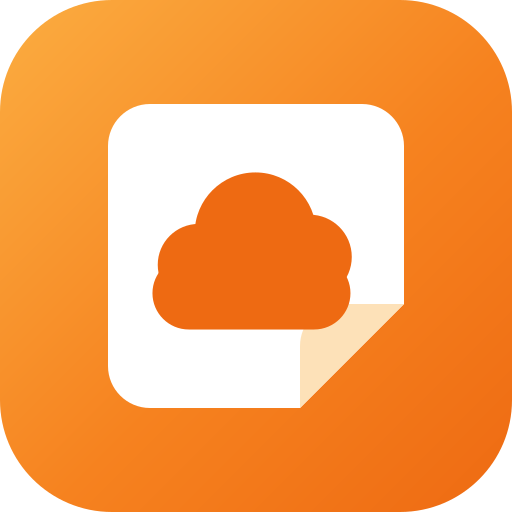
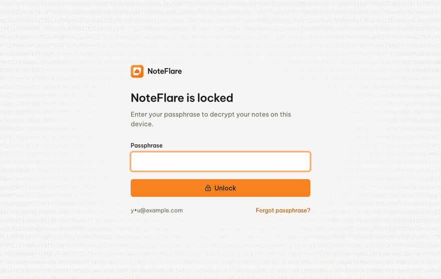
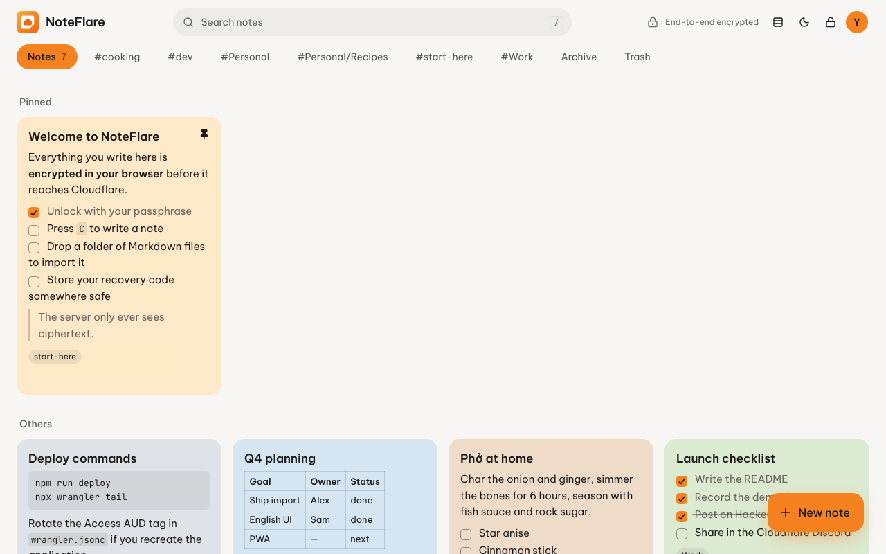
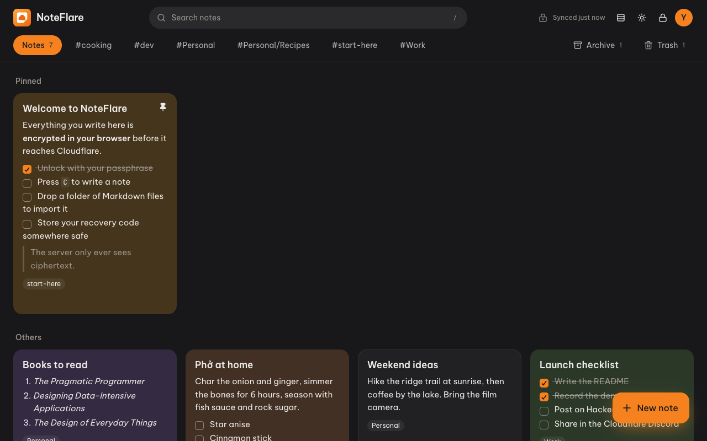
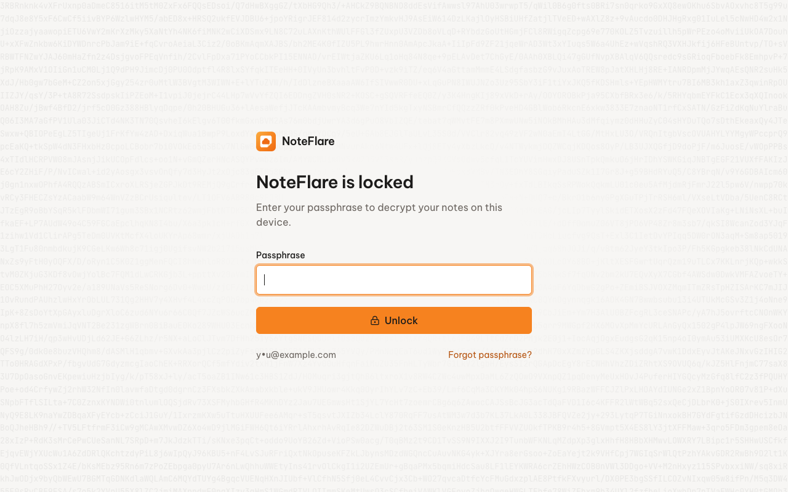
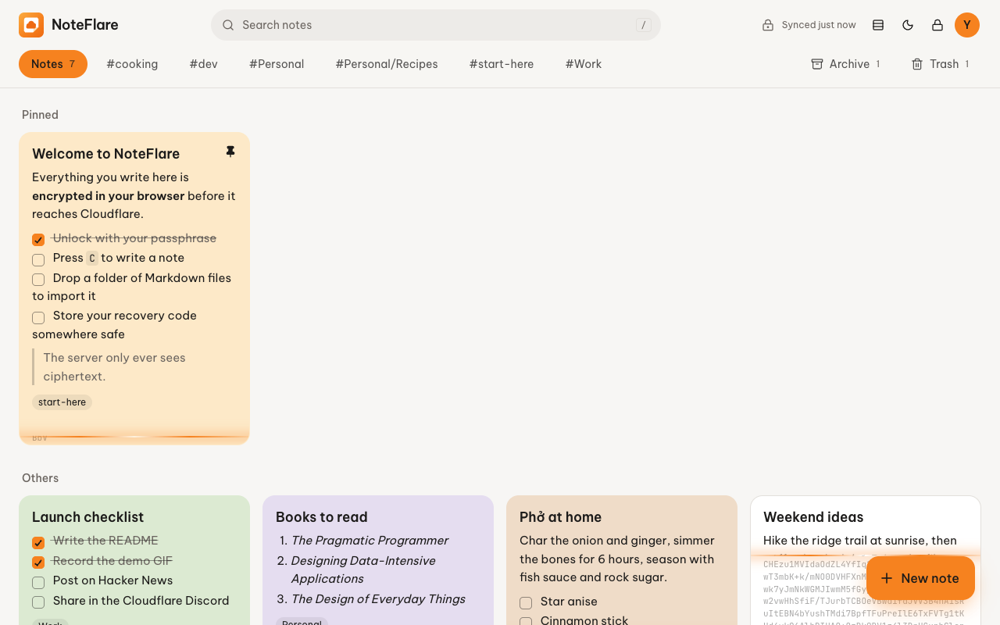
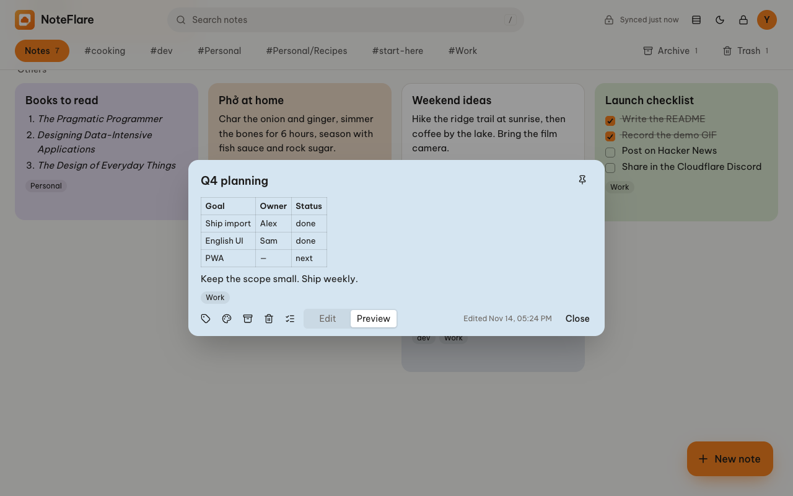
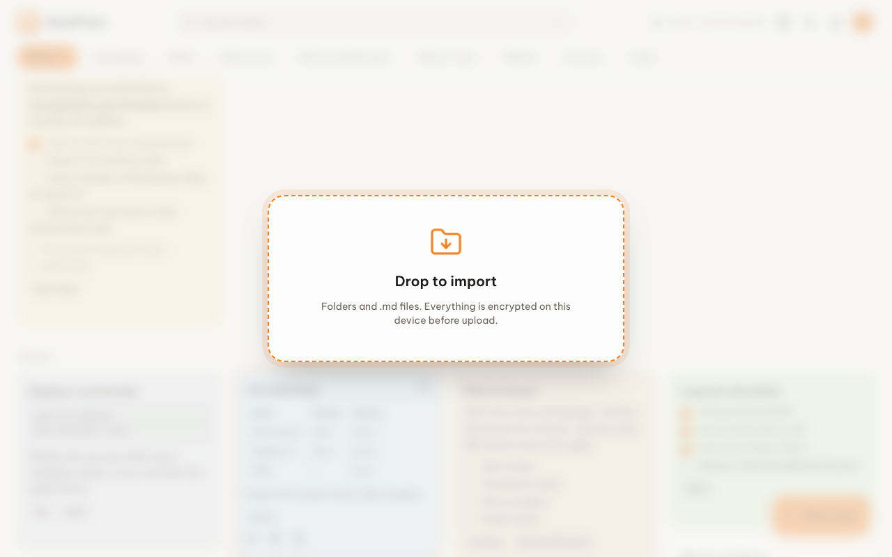
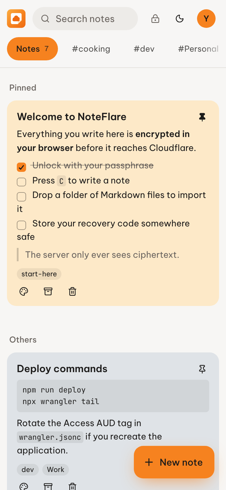
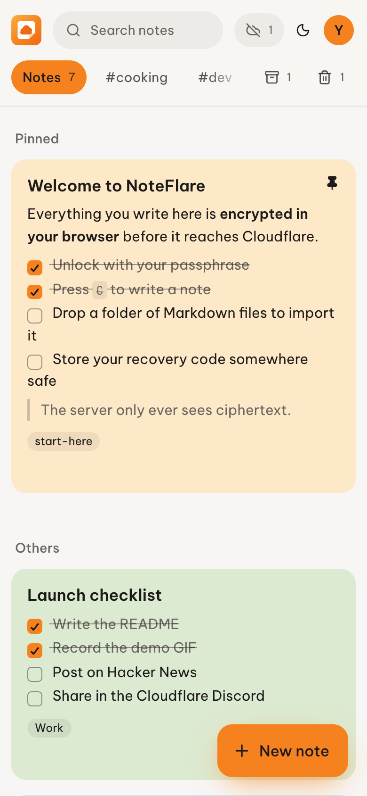

> [!WARNING]
> LOSE **BOTH** YOUR PASSPHRASE AND YOUR RECOVERY CODE AND YOUR NOTES ARE UNRECOVERABLE. THAT'S WHAT REAL END-TO-END ENCRYPTION MEANS.

<div align="center">



# NoteFlare

**Keep your notes on Cloudflare. Keep them to yourself.**

A simple, private, serverless notes app — end-to-end encrypted, completely free to run, and yours to customize.

[English](README.md) · [Tiếng Việt](README.vi.md)

[](https://deploy.workers.cloudflare.com/?url=https://github.com/homielab/noteflare)


[](https://ko-fi.com/homielab)



</div>

## ✨ Features

- 🔐 **End-to-end encryption**: Argon2id + AES-256-GCM in your browser. The server only ever stores ciphertext.
- 💸 **Completely free to run**: one Worker, one D1 database, Cloudflare Access — all on the free plan.
- 🎨 **Yours to customize**: plain React, Tailwind and shadcn/ui, a small Hono API and plain SQL migrations.
- 📝 **Markdown notes**: headings, tables, quotes, syntax-highlighted code and `- [ ]` checklists you can tick right on the card.
- 📌 **Organize your way**: pin, drag notes into the order you want, 8 paper colors, labels, archive, and a trash that empties itself after 30 days.
- 📥 **Drag-and-drop import**: drop a folder of Markdown (an Obsidian vault works) or a Google Keep export, and every note arrives encrypted.
- 📤 **Export and backup**: download your notes as Markdown, or as an encrypted backup you can restore later.
- 🖼️ **Encrypted images** (optional): attach images that are encrypted before upload, stored in your own R2 bucket.
- ✨ **Decrypt-in-place unlock**: watch every note resolve from ciphertext the moment you unlock.
- 📱 **Install it, use it offline**: add NoteFlare to your home screen like an app. Read, write and unlock without a connection; changes sync when you're back.
- 🔀 **Smart multi-device sync**: edits from two devices to the same note are merged line by line, like `git merge`. Only a true clash (same line, different text) becomes a separate copy.
- 🗝️ **Recovery code**: forget your passphrase without losing your notes, and change it without re-encrypting anything.
- 🔒 **Auto-lock**: keys are wiped from memory after 15 minutes idle or with one click.
- ✍️ **A Markdown editor that helps**: lists and checklists continue when you press Enter, Tab indents, and one tap turns lines into a checklist.
- 🌗 **Light and dark, grid or list, mobile-ready**, keyboard shortcuts (press `?` to see them) and reduced-motion support.
- 🔄 **Update notices and release notes in the app**, checked by your own Worker, with no tracking.
- 🌐 **English and Vietnamese** out of the box; adding a language is one file.
- 🔌 **Build your own clients**: personal access tokens, a stable `/api/v1` with an OpenAPI spec, a TypeScript SDK that handles the encryption, and a CLI.

> [!TIP]
> **Who is NoteFlare for?** People who want the simplicity of Google Keep without handing their notes to anyone —
> including the server they run on. It's built for individuals and small groups (Cloudflare Access is free for up to 50 users).

## 🪧 Screenshots

<table>
  <tr>
    <td width="50%"></td>
    <td width="50%"></td>
  </tr>
  <tr>
    <td></td>
    <td></td>
  </tr>
  <tr>
    <td></td>
    <td></td>
  </tr>
</table>

<p align="center">
  
  &nbsp;
  
</p>

## 📥 Import your Markdown

Drag a folder (or a few `.md` files) anywhere onto NoteFlare, or use **Account → Import a Markdown folder…**.
Files are read and encrypted in your browser and uploaded in batches. Try it with [`examples/sample-notes`](examples/sample-notes).

- **Title**: `title` in YAML frontmatter, else the first `# Heading`, else the file name
- **Labels**: `tags` from frontmatter (Obsidian style works) plus the sub-folder the file lives in
- **Also read**: `color`, `pinned`, `archived`
- **Skipped**: `.obsidian`, `.git`, `node_modules`, non-Markdown files, and notes you already have (same title and body) — importing twice is safe

**From Google Keep**: export Keep with [Google Takeout](https://takeout.google.com/), unzip it, and drop the `Keep` folder (or use **Account → Import from Google Keep…**). Titles, text, checklists, labels, colors, pinned and archived come across; notes in Keep's trash and attachments (images, audio) do not.

## 📤 Export and backup

**Account → Export and backup…** gives you three things:

- **Markdown (.zip)**: one readable `.md` file per note, with frontmatter, plus any attached images. It imports back into NoteFlare or opens in any Markdown editor. It is **not encrypted**, so keep it somewhere safe.
- **Encrypted backup**: one `.json` file with your notes exactly as the server stores them, still encrypted. It is useless without your passphrase. The trash and attached images are left out.
- **Restore**: pick an encrypted backup and its notes are added to your notebook; notes you already have are skipped. A backup from another deployment, or from before a recovery-code reset, asks for the passphrase that was in use when it was made.

## 🖼️ Images

Notes can carry images, encrypted like everything else. This is off by default because it needs an R2 bucket, and R2 asks for a payment method even on its free 10 GB.

To turn it on, uncomment the `r2_buckets` line in `wrangler.jsonc` and deploy; the bucket is created for you. Then **Add image** appears in the editor, and you can also paste or drop an image into a note.

- Images are encrypted in your browser with your data key before upload. The server stores opaque blobs and never learns the content or the file type.
- PNG, JPEG, GIF, WebP and AVIF, up to 10 MB each.
- Deleting a note forever also deletes the images only it used. Notes purged from the trash after 30 days leave their images in the bucket.
- Images need a connection the first time each device shows them.

## 📱 Install on your phone, use it offline

NoteFlare is a Progressive Web App. Open your NoteFlare URL and sign in once, then:

- **Android (Chrome)**: *Account menu → Install app*, or Chrome's menu → *Install app*
- **iPhone / iPad (Safari)**: *Share → Add to Home Screen* (*Account menu → Install app* shows the steps)
- **Desktop (Chrome, Edge)**: the install icon in the address bar, or *Account menu → Install app*

**What works offline**: opening the app, unlocking with your passphrase, reading, searching, writing, editing, pinning, archiving, deleting and importing. The header shows *Offline · N unsynced* until everything has reached your Worker. Setting up a new account and recovering with a recovery code need a connection.

**Once installed**:

- **Share to NoteFlare** from other apps (Android): shared text and links become a new note, saved as soon as you unlock.
- **Open `.md` files with NoteFlare** (desktop Chrome and Edge): they're encrypted and imported like a dropped folder.
- **New note** from the app icon's shortcut menu.
- Launching it again focuses the window you already have open, so you don't have to unlock twice.
- When a new version is deployed, NoteFlare offers to reload rather than switching underneath you.

**How it works**: a service worker caches the app itself. Your notes are cached by the app in IndexedDB — as the same ciphertext the server stores, plus the wrapped keys — so the device copy is just as unreadable without your passphrase. Edits go into a queue on the device and are pushed in order when a connection is available.

### What happens when two devices edit the same note

Every note has a version number. When a device pushes an edit built on an older version, the server refuses it, and the device merges the two edits from the version both started at:

| Device A | Device B | Result |
|---|---|---|
| Ticks the first item | Adds an item at the end | One note with both changes |
| Rewrites line 2 | Deletes line 5 | Both changes applied |
| Adds labels `work` | Adds label `q4`, removes `old` | `work`, `q4` — `old` removed |
| Renames the note to "A" | Renames it to "B" | Server copy kept, your edit saved as **"… (conflict copy)"** |
| Changes line 3 to "oat milk" | Changes line 3 to "soy milk" | Same: nothing is lost, you pick which to keep |

Merging happens in the browser on decrypted text; the server never sees note content. Colors, pin and archive never cause a copy: the edit from the device that syncs later wins.

### Tips for Cloudflare Access on phones

- An app added to the iPhone home screen keeps its own cookies, separate from Safari, so you sign in once inside the app.
- Access sessions last 24 hours by default. For a notes app you open every day, raise **Session Duration** on the Access application (e.g. 1 week or 1 month). When a session expires, NoteFlare keeps working on the device copy and shows *Sign in to sync*.
- If your browser doesn't offer to install the app, or the home-screen icon is blank, the browser may be fetching the icons without your Access cookie. Add a second Access application for the paths `/manifest.webmanifest` and `/icons/` with a **Bypass** policy (they contain only the app name and icons).

## 🔌 Integrations and API

Connect scripts, editor plugins, browser extensions or your own apps. Create a token under **Account → Integrations** (read-only or read-and-write, with an expiry), then:

```ts
import { NoteFlareClient } from '@noteflare/client'

const nf = new NoteFlareClient({ url: 'https://notes.example.com', token: 'nf_…' })
await nf.unlock(passphrase)                       // decryption stays on your side
await nf.create({ title: 'From my script', body: '- [ ] it works' })
```

```bash
echo "- [ ] Pack a jacket" | noteflare append "trip"     # the CLI in packages/cli
noteflare export ./backup                                 # Markdown you can re-import
```

Tokens reach only the encrypted copy: a client still needs your passphrase to read anything. The **[API guide](docs/API.md)** covers the endpoints, syncing, conflict handling, Cloudflare Access setup for `/api/v1`, and the exact encryption format with a Python example — so clients can be written in any language. The OpenAPI spec is served at `/api/v1/openapi.json`.

## 🔐 How the encryption works

```
passphrase    ──Argon2id (64 MiB, t=3)──► KEK  ──AES-GCM wrap──► wrappedDek   ┐
recovery code ──HKDF-SHA256─────────────► RKEK ──AES-GCM wrap──► recoveryDek  ├─ stored in D1
random 256-bit DEK ──AES-GCM, AAD = "note:<id>"──► note ciphertext            ┘
                   ──AES-GCM, AAD = "blob:<id>"──► image ciphertext (R2, optional)
```

- Your passphrase, the data key (DEK) and note content never leave the browser unencrypted. Titles, bodies, labels and colors are all inside the ciphertext; only `pinned`, `archived`, `trashed_at`, `position` and timestamps are plaintext so notes can be sorted.
- In a session the DEK is a **non-extractable** `CryptoKey` kept in memory only. Locking discards it.
- The offline copy on your device holds the same ciphertext and wrapped keys as the server. Signing out deletes it.
- Each note's ciphertext is bound to its id, so the server can't swap content between notes.
- The client rejects Argon2 parameters below a safe floor, so a malicious server can't downgrade the KDF.
- The Worker verifies the Cloudflare Access JWT itself (signature, issuer, audience) instead of trusting headers.
- A strict CSP ships in `public/_headers`; TanStack Markdown escapes raw HTML and drops executable URLs by default.

## 🧱 Tech stack

- **Runtime**: [Cloudflare Workers](https://workers.cloudflare.com/) with [Static Assets](https://developers.cloudflare.com/workers/static-assets/) and a Cron Trigger
- **Database**: [Cloudflare D1](https://developers.cloudflare.com/d1/) (SQLite)
- **Auth**: [Cloudflare Access](https://www.cloudflare.com/zero-trust/products/access/), verified with [jose](https://github.com/panva/jose)
- **API**: [Hono](https://hono.dev/)
- **UI**: [React 19](https://react.dev/), [Tailwind CSS 4](https://tailwindcss.com/), [shadcn/ui](https://ui.shadcn.com/), [lucide](https://lucide.dev/), View Transitions API
- **Markdown**: [TanStack Markdown](https://github.com/TanStack/markdown), with [TanStack Highlight](https://github.com/TanStack/highlight) for code
- **Images** (optional): [Cloudflare R2](https://developers.cloudflare.com/r2/)
- **Crypto**: WebCrypto + [hash-wasm](https://github.com/Daninet/hash-wasm) (Argon2id)
- **Offline**: a Service Worker for the app shell, IndexedDB via [idb](https://github.com/jakearchibald/idb) for encrypted notes and the sync queue

## 🏗️ Deploy

### One click (no coding needed)

You need a free [Cloudflare](https://dash.cloudflare.com/sign-up) account and a free [GitHub](https://github.com/signup) account. It takes about 10 minutes.

**Part 1: Deploy the app**

1. Click the **Deploy to Cloudflare** button at the top of this page and sign in to Cloudflare.
2. Under **Git account**, connect your GitHub account. Keep **Create private Git repository** ticked.
3. Fill in the form. Almost everything stays as it is:

   | Field | What to do |
   | --- | --- |
   | Project name | Keep `noteflare`. |
   | D1 database | Keep **Create new** and the name `noteflare`. Leave read replication off. |
   | `ACCESS_TEAM_DOMAIN` | Type `todo`. You replace it in Part 2. |
   | `ACCESS_AUD` | Type `todo`. The form does not accept an empty value. You replace it in Part 2. |
   | `ALLOWED_EMAILS` | Type your own email address. |
   | `UPDATE_CHECK_REPO` | Keep `homielab/noteflare`. |
   | Build and deploy commands | Don't change them. |

4. Click **Create and deploy** and wait a few minutes until it finishes.
5. Open the link Cloudflare shows you (it looks like `noteflare.<your-subdomain>.workers.dev`). The page says *Your session has expired. Sign in again*. That is correct: NoteFlare stays locked until you finish Part 2.

**Part 2: Lock it so only you can sign in**

Follow [Turn on Cloudflare Access](#turn-on-cloudflare-access) below.

**Part 3: Create your passphrase**

1. Open your NoteFlare link again and sign in with the code Cloudflare emails you.
2. Choose a passphrase. This is what encrypts your notes.
3. Write down the **recovery code** and keep it somewhere safe, away from your passphrase.

### Command line

Requires [Bun](https://bun.sh), Node 20+ and a Cloudflare account.

```bash
bun install
bunx wrangler login
bun run deploy   # build → deploy the Worker (creates D1) → apply migrations (including new ones on upgrade)
```

### Turn on Cloudflare Access

Cloudflare Access is the login page in front of your notes. It is free for up to 50 people.

1. In the [Cloudflare dashboard](https://dash.cloudflare.com), open **Zero Trust**. The first time, it asks you to pick a team name and the Free plan. Remember the team name.
2. Go to **Access controls → Applications → Create new application → Self-hosted and private**.
   - Name: `NoteFlare`
   - Select **Add public hostname** and enter your NoteFlare address, e.g. `notes.example.com` or `noteflare.<your-subdomain>.workers.dev`

   For a `workers.dev` link you can also turn Access on in **Workers & Pages → noteflare → Settings → Domains & Routes**.
3. Add a policy: *Allow* → *Emails* → your email address. Save the application. Login by emailed one-time code works right away; Google or GitHub login also work.
4. Copy the **Application Audience (AUD) Tag**: in **Access controls → Applications**, select **Edit** on NoteFlare, open **Additional settings**, and copy the value (a long string of letters and numbers).
5. Put both values into `wrangler.jsonc`. If you used the one-click button, open your new `noteflare` repository on GitHub, open `wrangler.jsonc`, click the pencil icon, and edit these lines:

   ```jsonc
   "vars": {
     "ACCESS_TEAM_DOMAIN": "https://<your-team>.cloudflareaccess.com",
     "ACCESS_AUD": "<AUD tag>",
     "ALLOWED_EMAILS": "you@example.com"   // optional second lock, checked by the Worker
   }
   ```

6. Deploy again. On GitHub, click **Commit changes** and Cloudflare redeploys by itself in a few minutes. On the command line, run `bun run deploy`.
7. Open your NoteFlare link. You should now see the Cloudflare login page, then NoteFlare.

Then run through the [hardening checklist](SECURITY.md#hardening-checklist-for-your-deployment).

## 🔄 Update

NoteFlare tells you when a new version is out: a badge appears on your avatar, and **About and updates** in the account menu shows the release notes. After you update, **What's new** lists what changed.

The check runs on your Worker, not in your browser. It asks GitHub for the latest release of `homielab/noteflare` at most every 6 hours and sends nothing about you or your notes. Set `UPDATE_CHECK_REPO` in `wrangler.jsonc` to your fork's `owner/repo` to follow your own releases, or to `"off"` to turn it off.

**Deployed with the button?** Cloudflare created a copy of this repo in your GitHub account and redeploys on every push. Pull the new release into it:

```bash
# The first time only: your copy has its own history, so link the two.
git clone https://github.com/<you>/noteflare && cd noteflare
git remote add upstream https://github.com/homielab/noteflare
git pull upstream main --no-rebase --allow-unrelated-histories -X theirs --no-commit
git checkout HEAD -- wrangler.jsonc      # keep your own settings (database id, Access values)
git commit -m "Update NoteFlare"
git push                                 # Workers Builds deploys it

# Every time after that:
git pull upstream main --no-rebase
git push
```

If a later pull reports a conflict in `wrangler.jsonc`, keep yours with `git checkout --ours wrangler.jsonc`, then `git commit` and `git push`. The release notes say when `wrangler.jsonc` itself gained something you may want to copy over.

**Deployed from the command line?**

```bash
git pull
bun install
bun run deploy   # also applies new database migrations
```

Your notes, keys and settings live in D1 and stay untouched; migrations only ever add to the schema. Read the [changelog](CHANGELOG.md) for anything marked **Breaking** before a minor-version update.

## 🧑‍💻 Develop locally

```bash
cp dev.vars.sample .dev.vars     # DEV_USER_EMAIL=you@example.com — local only
bun run db:migrate:local
bun run dev:api                  # terminal 1: Worker + local D1 on :8787
bun run dev                      # terminal 2: Vite on :5173, proxies /api
bun run test                         # crypto, Access JWT, offline sync, merging, import, tokens
bun run build:client             # build the SDK (packages/client)
```

`DEV_USER_EMAIL` is honored only while the Access variables are empty **and** the request is to `localhost`, so it can never open a deployed app. Still, don't set it in production.

The service worker only exists in production builds. To try offline mode locally, run `bun run build && bun run dev:api` and open http://localhost:8787.

## 💸 Free-tier budget

| Service | Free allowance | How NoteFlare uses it |
|---|---|---|
| Workers | 100,000 requests/day | One request per save; saves are debounced (~0.7 s) |
| D1 | 5M rows read, 100k rows written per day; 500 MB per database | Refreshes only fetch notes changed since the last sync |
| Access | 50 users | One seat per person you let in |
| R2 (optional) | 10 GB stored | Only if you turn on [images](#️-images); one object per image |

Personal use stays far below these limits. If a D1 daily limit is ever hit, queries pause until 00:00 UTC — nothing is lost.

## 🎨 Customize

| Want to… | Edit |
|---|---|
| Restyle colors, fonts, note palette, motion | `src/index.css` — tokens at the top, motion at the bottom |
| Edit UI text or add a language | `src/i18n/en.ts` (keys), add e.g. `fr.ts` and register it in `src/i18n/index.tsx` |
| Tune encryption cost | `DEFAULT_KDF` in `packages/client/src/crypto.ts` |
| Change auto-lock / autosave timing | `IDLE_LOCK_MS` in `src/lib/vault.tsx`, `DEBOUNCE_MS` in `src/lib/sync/engine.ts` |
| Highlight more languages in code blocks | `src/lib/highlight.ts` |
| Change how edits from two devices merge | `packages/client/src/merge.ts` (tested in `tests/merge.test.ts`) |
| Change the app icon or install name | `public/icons/`, `public/manifest.webmanifest` |
| Change trash retention | `TRASH_TTL_MS` in `worker/index.ts`, `triggers.crons` in `wrangler.jsonc` |
| Add API routes | `worker/index.ts` (Hono); public ones also go in `worker/openapi.ts` and `docs/API.md` |
| Change the encryption or wire format | `packages/client/src/` — shared by the web app, the Worker and the SDK |
| Follow your fork's releases, or turn off update checks | `UPDATE_CHECK_REPO` in `wrangler.jsonc` |
| Add UI components | `bunx shadcn@latest add <component>` |

## 🚗 Roadmap

Contributions are welcome. Read [CONTRIBUTING.md](CONTRIBUTING.md), and open an issue to talk through bigger changes first.

- [x] End-to-end encryption with recovery code
- [x] Markdown with tickable checklists
- [x] Labels, pin, archive, trash with auto-purge
- [x] Decrypt-in-place unlock and View Transitions
- [x] English and Vietnamese UI
- [x] Drag-and-drop Markdown import
- [x] Installable app that works offline
- [x] Automatic three-way merge across devices
- [x] Public API, access tokens, TypeScript SDK and CLI
- [x] Export to Markdown (CLI)
- [x] Export from the web app, encrypted backup and restore
- [x] Drag-and-drop reordering
- [x] Encrypted image attachments on R2
- [x] Google Keep Takeout import
- [x] Code highlighting via TanStack Highlight

## 🙋 FAQ

**Can Cloudflare read my notes?** No. Notes are encrypted in your browser before they're sent; D1 only holds ciphertext and wrapped keys.

**Can I script it or build my own app?** Yes. See [Integrations and API](#-integrations-and-api): tokens, a TypeScript SDK, a CLI, and a documented encryption format for other languages.

**Is there a mobile app?** NoteFlare installs from the browser as an app (see [Install on your phone](#-install-on-your-phone-use-it-offline)) and works offline. There's no App Store build.

**What if I edit the same note on my phone and laptop?** Changes to different lines are merged automatically. If both devices changed the same line differently, you get both versions: the other device's in the note, yours in a "conflict copy" next to it.

**Why Cloudflare Access instead of a password login?** Access handles sign-in, MFA and sessions at Cloudflare's edge for free, so the app ships no auth code to get wrong. Your passphrase is a separate secret used only for encryption.

**Is it really free?** On Cloudflare's free plan, yes, within the limits above. There's no paid service in the stack.

**Can I bring my Obsidian vault?** Yes — drop the vault folder. Frontmatter tags become labels, sub-folders become labels, and `.obsidian/` is ignored. Wiki-links and embeds are kept as plain text.

**I forgot my passphrase.** Use **Forgot passphrase?** on the lock screen with your recovery code. Without either, the data can't be decrypted — by design.

## 📚 Documentation

| Doc | For |
| --- | --- |
| [API guide](docs/API.md) | Building scripts and apps on `/api/v1`, the SDK and the CLI |
| [Architecture](docs/ARCHITECTURE.md) | How the Worker, D1, encryption and offline sync fit together |
| [Security](SECURITY.md) | Threat model, what the server can see, reporting vulnerabilities |
| [Contributing](CONTRIBUTING.md) | Local setup, tests and pull request checklist |
| [Changelog](CHANGELOG.md) | What changed in each release |

## 💖 Credits

[Cloudflare](https://www.cloudflare.com/) · [TanStack Markdown](https://github.com/TanStack/markdown) · [shadcn/ui](https://ui.shadcn.com/) · [Hono](https://hono.dev/) · [hash-wasm](https://github.com/Daninet/hash-wasm) · [Be Vietnam Pro](https://fonts.google.com/specimen/Be+Vietnam+Pro)

NoteFlare is an independent project and is not affiliated with Cloudflare or Google. Its orange palette is a nod to the platform it runs on; the logo is original and doesn't use Cloudflare's trademarks.

## 📄 License

[MIT](LICENSE)

## ⭐ Support

NoteFlare is free, with no ads and no tracking, and it stays that way. If it keeps your notes safe:

- **Star the repo** so others can find it.
- **[Buy me a coffee on Ko-fi](https://ko-fi.com/homielab)** to fund the time that goes into it.
- **Tell us you deployed it** in [Discussions](https://github.com/homielab/noteflare/discussions). There's no telemetry, so that's how we know it works.

[](https://ko-fi.com/homielab)

[](https://star-history.com/#homielab/noteflare&Date)
