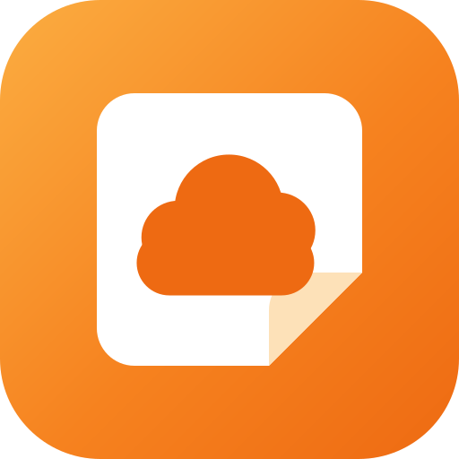
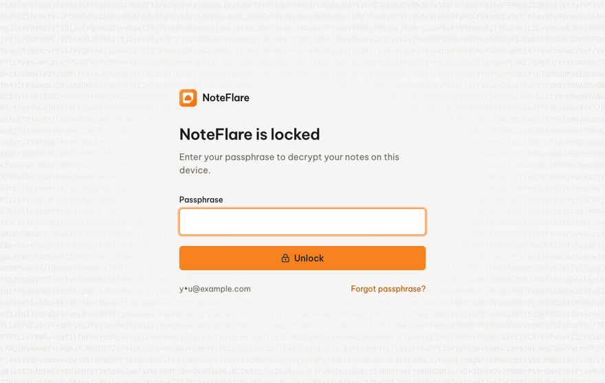
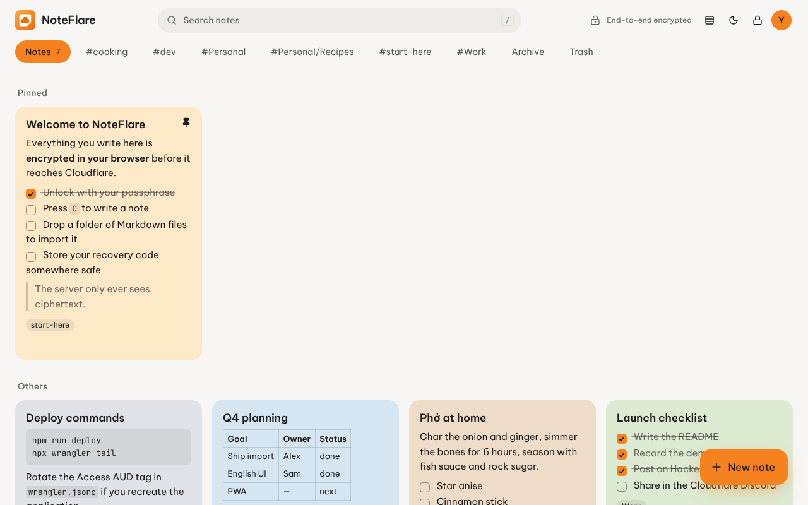
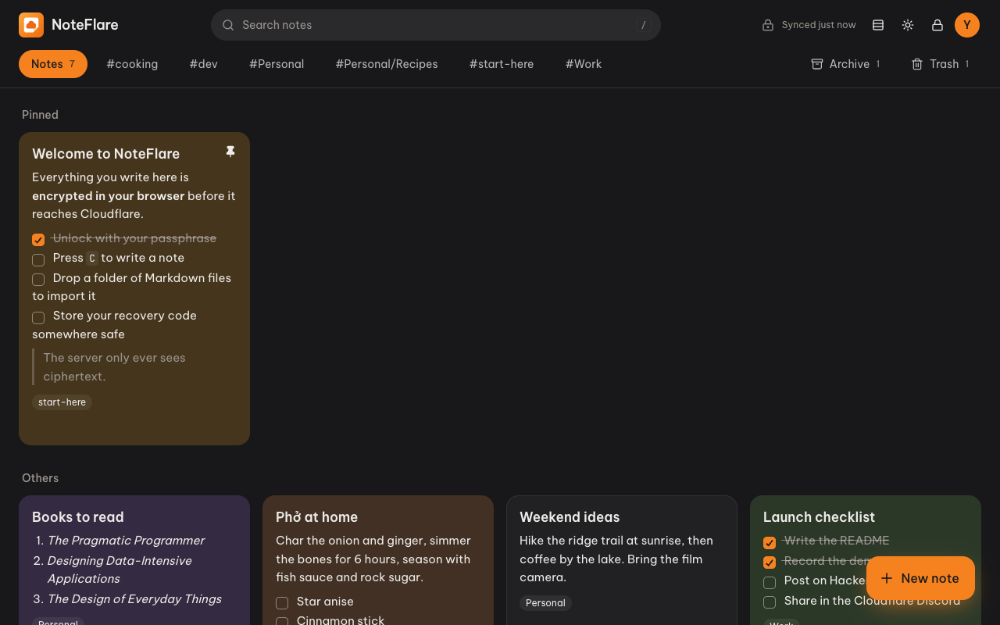
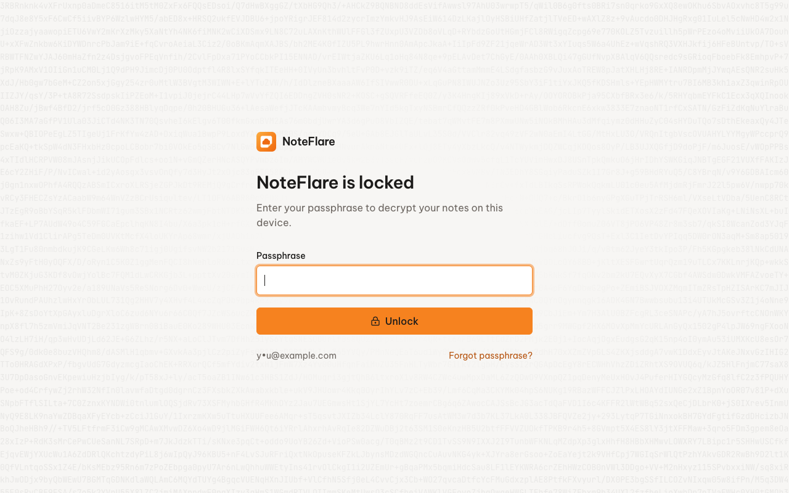
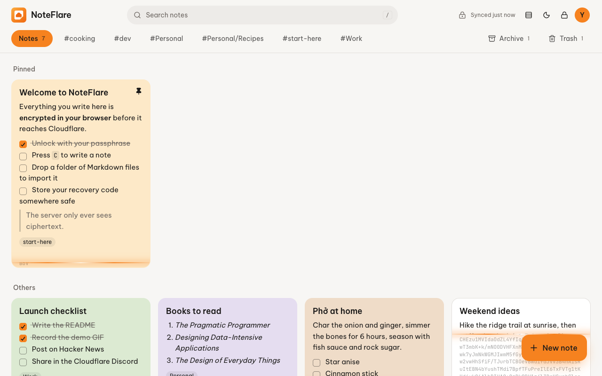
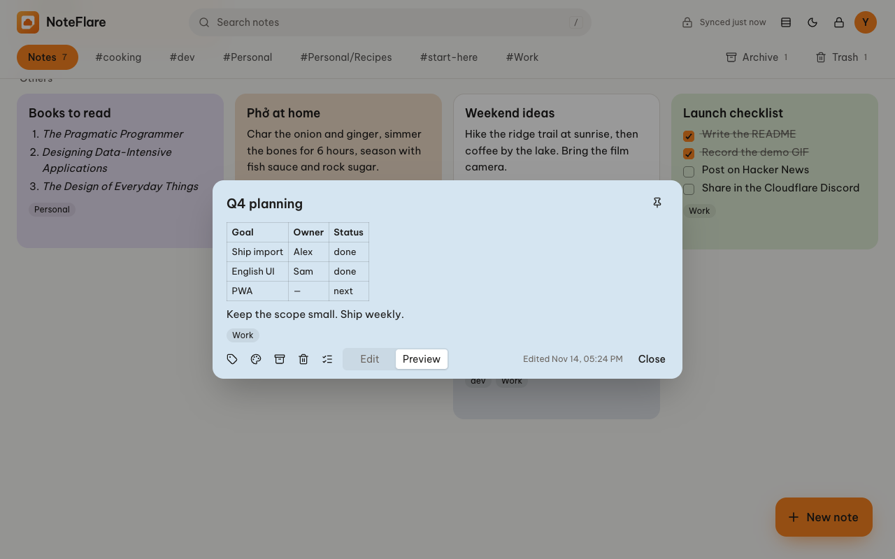
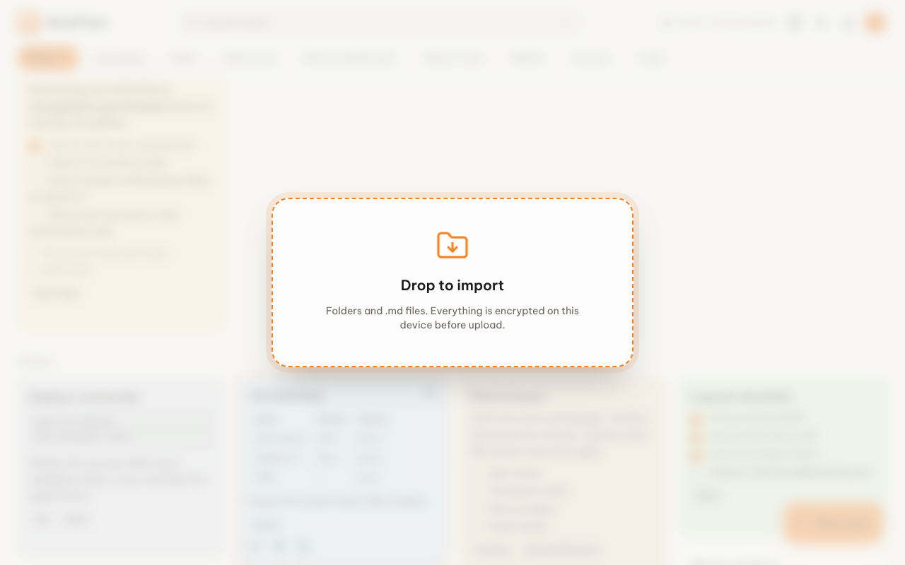
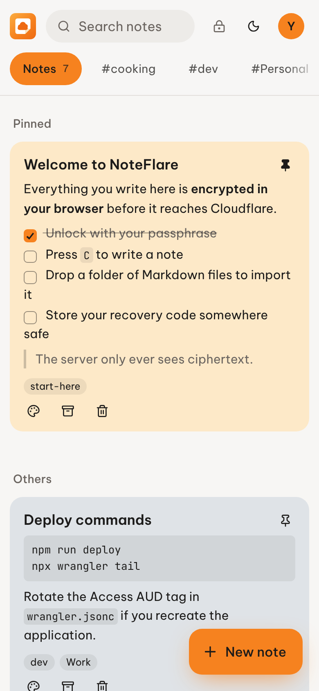
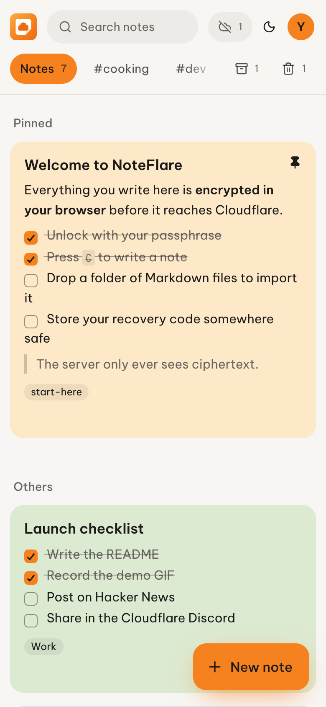

> [!WARNING]
> MẤT **CẢ** PASSPHRASE LẪN MÃ KHÔI PHỤC THÌ GHI CHÚ KHÔNG THỂ KHÔI PHỤC. ĐÓ CHÍNH LÀ Ý NGHĨA CỦA MÃ HOÁ ĐẦU-CUỐI.

<div align="center">



# NoteFlare

**Ghi chú trên Cloudflare, chỉ mình bạn đọc được.**

App ghi chú đơn giản, riêng tư, không cần máy chủ — mã hoá đầu-cuối, chạy miễn phí hoàn toàn, tuỳ biến theo ý bạn.

[English](README.md) · [Tiếng Việt](README.vi.md)

[](https://deploy.workers.cloudflare.com/?url=https://github.com/homielab/noteflare)


[](https://ko-fi.com/homielab)



</div>

## ✨ Tính năng

- 🔐 **Mã hoá đầu-cuối**: Argon2id + AES-256-GCM ngay trong trình duyệt. Máy chủ chỉ lưu ciphertext.
- 💸 **Chạy miễn phí hoàn toàn**: một Worker, một database D1, Cloudflare Access — tất cả trên gói Free.
- 🎨 **Tuỳ biến theo ý bạn**: React, Tailwind, shadcn/ui thuần; API khoảng 300 dòng; một file migration SQL.
- 📝 **Ghi chú markdown**: tiêu đề, code, bảng, trích dẫn, checklist `- [ ]` tick ngay trên thẻ.
- 📌 **Sắp xếp theo cách của bạn**: ghim, 8 màu giấy, nhãn, lưu trữ, thùng rác tự dọn sau 30 ngày.
- 📥 **Kéo thả để nhập**: thả một thư mục Markdown (vault Obsidian cũng được), mọi file `.md` thành ghi chú đã mã hoá.
- ✨ **Mở khoá là giải mã tại chỗ**: từng ghi chú hiện ra từ ciphertext ngay khi bạn mở khoá.
- 📱 **Cài như app, dùng được khi offline**: thêm NoteFlare vào màn hình chính. Đọc, viết, mở khoá không cần mạng; có mạng lại thì tự đồng bộ.
- 🔀 **Đồng bộ nhiều thiết bị thông minh**: hai máy cùng sửa một ghi chú thì được gộp theo từng dòng, giống `git merge`. Chỉ khi sửa cùng một dòng khác nhau mới tách thành bản riêng.
- 🗝️ **Mã khôi phục**: quên passphrase vẫn không mất ghi chú; đổi passphrase không cần mã hoá lại.
- 🔒 **Tự khoá**: khoá bị xoá khỏi bộ nhớ sau 15 phút không thao tác, hoặc chỉ với một cú nhấp.
- ✍️ **Trình soạn Markdown biết giúp bạn**: danh sách và checklist tự nối dòng khi nhấn Enter, Tab để thụt lề, một chạm để biến các dòng thành checklist.
- 🌗 **Sáng/tối, dạng lưới hoặc danh sách, dùng tốt trên điện thoại**, phím tắt (nhấn `?` để xem), tôn trọng chế độ giảm chuyển động.
- 🔄 **Thông báo cập nhật và ghi chú phát hành ngay trong app**, do chính Worker của bạn kiểm tra, không theo dõi.
- 🌐 **Tiếng Anh (mặc định) và tiếng Việt**, đổi trong menu tài khoản; thêm ngôn ngữ chỉ cần một file.
- 🔌 **Tự xây client riêng**: token truy cập, API `/api/v1` ổn định có spec OpenAPI, SDK TypeScript lo phần mã hoá, và CLI.

> [!TIP]
> **NoteFlare dành cho ai?** Cho người muốn sự đơn giản của Google Keep mà không phải giao ghi chú cho ai —
> kể cả máy chủ đang chạy app. Phù hợp với cá nhân và nhóm nhỏ (Cloudflare Access miễn phí tới 50 người).

## 🪧 Ảnh chụp

<table>
  <tr>
    <td width="50%"></td>
    <td width="50%"></td>
  </tr>
  <tr>
    <td></td>
    <td></td>
  </tr>
  <tr>
    <td></td>
    <td></td>
  </tr>
</table>

<p align="center">
  
  &nbsp;
  
</p>

## 📥 Nhập Markdown

Kéo một thư mục (hoặc vài file `.md`) thả vào bất cứ đâu trên NoteFlare, hoặc chọn **Tài khoản → Nhập thư mục Markdown…**.
File được đọc và mã hoá ngay trong trình duyệt rồi tải lên theo lô. Thử với [`examples/sample-notes`](examples/sample-notes).

- **Tiêu đề**: `title` trong frontmatter YAML, nếu không có thì lấy dòng `# Heading` đầu tiên, cuối cùng là tên file
- **Nhãn**: `tags` trong frontmatter (kiểu Obsidian) cộng với thư mục con chứa file
- **Đọc thêm**: `color`, `pinned`, `archived`
- **Bỏ qua**: `.obsidian`, `.git`, `node_modules`, file không phải Markdown và ghi chú đã có (cùng tiêu đề và nội dung) — nhập hai lần vẫn an toàn

## 📱 Cài lên điện thoại, dùng khi offline

NoteFlare là Progressive Web App. Mở địa chỉ NoteFlare của bạn, đăng nhập một lần, rồi:

- **Android (Chrome)**: *menu Tài khoản → Cài ứng dụng*, hoặc menu Chrome → *Cài đặt ứng dụng*
- **iPhone / iPad (Safari)**: *Chia sẻ → Thêm vào Màn hình chính* (*menu Tài khoản → Cài ứng dụng* sẽ hiện các bước)
- **Máy tính (Chrome, Edge)**: biểu tượng cài đặt trên thanh địa chỉ, hoặc *menu Tài khoản → Cài ứng dụng*

**Dùng được khi offline**: mở app, mở khoá bằng passphrase, đọc, tìm kiếm, viết, sửa, ghim, lưu trữ, xoá và nhập Markdown. Header hiện *Offline · N chưa đồng bộ* cho tới khi mọi thay đổi lên tới Worker. Tạo tài khoản mới và khôi phục bằng mã cần có mạng.

**Sau khi cài**:

- **Chia sẻ vào NoteFlare** từ app khác (Android): chữ và link được chia sẻ thành ghi chú mới, lưu ngay khi bạn mở khoá.
- **Mở file `.md` bằng NoteFlare** (Chrome, Edge trên máy tính): file được mã hoá và nhập như khi kéo thả thư mục.
- **Ghi chú mới** từ menu phím tắt của biểu tượng app.
- Mở lại app sẽ chuyển tới cửa sổ đang mở, không phải mở khoá lại lần nữa.
- Khi có phiên bản mới, NoteFlare hỏi bạn tải lại thay vì tự đổi giữa chừng.

**Cách hoạt động**: service worker lưu sẵn bản thân ứng dụng. Ghi chú được app lưu trong IndexedDB — đúng loại ciphertext mà máy chủ giữ, cùng khoá đã bọc — nên bản trên máy cũng không đọc được nếu thiếu passphrase. Thay đổi được xếp hàng trên máy và gửi lên theo thứ tự khi có mạng.

### Khi hai thiết bị cùng sửa một ghi chú

Mỗi ghi chú có số phiên bản. Khi một máy gửi bản sửa dựa trên phiên bản cũ, máy chủ từ chối, và máy đó gộp hai bản sửa dựa trên phiên bản gốc mà cả hai cùng bắt đầu:

| Máy A | Máy B | Kết quả |
|---|---|---|
| Tick mục đầu tiên | Thêm một mục ở cuối | Một ghi chú có cả hai thay đổi |
| Sửa dòng 2 | Xoá dòng 5 | Cả hai thay đổi đều được áp dụng |
| Thêm nhãn `work` | Thêm nhãn `q4`, bỏ `old` | `work`, `q4` — `old` bị bỏ |
| Đổi tên thành "A" | Đổi tên thành "B" | Giữ bản trên máy chủ, bản của bạn lưu thành **"… (conflict copy)"** |
| Sửa dòng 3 thành "sữa yến mạch" | Sửa dòng 3 thành "sữa đậu nành" | Như trên: không mất gì, bạn chọn bản muốn giữ |

Việc gộp chạy trong trình duyệt trên nội dung đã giải mã; máy chủ không bao giờ thấy nội dung. Màu, ghim, lưu trữ không bao giờ tạo bản sao: máy đồng bộ sau thắng.

### Mẹo dùng Cloudflare Access trên điện thoại

- App thêm vào màn hình chính trên iPhone có cookie riêng, tách khỏi Safari, nên bạn đăng nhập một lần ngay trong app.
- Phiên Access mặc định kéo dài 24 giờ. Với app ghi chú mở hằng ngày, hãy tăng **Session Duration** của Access application (ví dụ 1 tuần hoặc 1 tháng). Khi phiên hết hạn, NoteFlare vẫn chạy trên bản trên máy và hiện *Đăng nhập để đồng bộ*.
- Nếu trình duyệt không đề nghị cài app, hoặc biểu tượng trên màn hình chính bị trống, có thể trình duyệt đang tải icon mà không kèm cookie Access. Thêm một Access application thứ hai cho đường dẫn `/manifest.webmanifest` và `/icons/` với policy **Bypass** (chúng chỉ chứa tên app và icon).

## 🔌 Tích hợp và API

Kết nối script, plugin cho editor, extension trình duyệt hay ứng dụng của riêng bạn. Tạo token ở **Tài khoản → Tích hợp** (chỉ đọc hoặc đọc và ghi, có hạn dùng), rồi:

```ts
import { NoteFlareClient } from '@noteflare/client'

const nf = new NoteFlareClient({ url: 'https://notes.example.com', token: 'nf_…' })
await nf.unlock(passphrase)                       // giải mã vẫn diễn ra ở phía bạn
await nf.create({ title: 'Từ script của tôi', body: '- [ ] chạy rồi' })
```

```bash
echo "- [ ] Mang áo khoác" | noteflare append "trip"      # CLI trong packages/cli
noteflare export ./backup                                 # Markdown nhập lại được
```

Token chỉ lấy được bản đã mã hoá: client vẫn cần passphrase của bạn mới đọc được. **[Hướng dẫn API](docs/API.md)** (tiếng Anh) mô tả các endpoint, đồng bộ, xử lý xung đột, cấu hình Cloudflare Access cho `/api/v1` và định dạng mã hoá chính xác kèm ví dụ Python — để viết client bằng bất kỳ ngôn ngữ nào. Spec OpenAPI có tại `/api/v1/openapi.json`.

## 🔐 Mã hoá hoạt động thế nào

```
passphrase    ──Argon2id (64 MiB, t=3)──► KEK  ──AES-GCM wrap──► wrappedDek   ┐
mã khôi phục  ──HKDF-SHA256─────────────► RKEK ──AES-GCM wrap──► recoveryDek  ├─ lưu trong D1
DEK ngẫu nhiên 256-bit ──AES-GCM, AAD = "note:<id>"──► ciphertext của note    ┘
```

- Passphrase, khoá dữ liệu (DEK) và nội dung note không bao giờ rời trình duyệt ở dạng rõ. Chỉ `pinned`, `archived`, `trashed_at`, `position` và thời gian sửa là dạng rõ để sắp xếp.
- Trong phiên làm việc, DEK là `CryptoKey` **non-extractable**, chỉ nằm trong RAM. Khoá là xoá nó đi.
- Bản offline trên máy chỉ chứa ciphertext và khoá đã bọc giống máy chủ. Đăng xuất sẽ xoá nó.
- Ciphertext mỗi note gắn với id của nó, máy chủ không tráo nội dung giữa các note được.
- Client từ chối tham số Argon2 yếu hơn ngưỡng an toàn, chống máy chủ hạ cấp KDF.
- Worker tự kiểm tra JWT của Cloudflare Access (chữ ký, issuer, audience), không tin header suông.

## 🧱 Công nghệ

Cloudflare Workers (Static Assets, Cron Trigger) · D1 · Cloudflare Access + jose · Hono · React 19 · Tailwind CSS 4 · shadcn/ui · View Transitions API · TanStack Markdown · WebCrypto + hash-wasm · Service Worker + IndexedDB (idb)

## 🏗️ Triển khai

### Một cú nhấp (không cần biết lập trình)

Bạn cần một tài khoản [Cloudflare](https://dash.cloudflare.com/sign-up) miễn phí và một tài khoản [GitHub](https://github.com/signup) miễn phí. Mất khoảng 10 phút.

**Phần 1: Triển khai app**

1. Nhấn nút **Deploy to Cloudflare** ở đầu trang này và đăng nhập Cloudflare.
2. Ở mục **Git account**, kết nối tài khoản GitHub của bạn. Giữ nguyên dấu tick **Create private Git repository**.
3. Điền form. Hầu hết giữ nguyên:

   | Ô | Cần làm gì |
   | --- | --- |
   | Project name | Giữ `noteflare`. |
   | D1 database | Giữ **Create new** và tên `noteflare`. Không bật read replication. |
   | `ACCESS_TEAM_DOMAIN` | Nhập `todo`. Bạn sẽ thay nó ở Phần 2. |
   | `ACCESS_AUD` | Nhập `todo`. Form không cho để trống. Bạn sẽ thay nó ở Phần 2. |
   | `ALLOWED_EMAILS` | Nhập email của chính bạn. |
   | `UPDATE_CHECK_REPO` | Giữ `homielab/noteflare`. |
   | Lệnh build và deploy | Không sửa. |

4. Nhấn **Create and deploy** và chờ vài phút cho tới khi xong.
5. Mở đường link Cloudflare đưa cho bạn (dạng `noteflare.<subdomain>.workers.dev`). Trang hiện *Your session has expired. Sign in again* (Phiên đăng nhập đã hết hạn). Như vậy là đúng: NoteFlare bị khoá cho tới khi bạn làm xong Phần 2.

**Phần 2: Khoá lại để chỉ mình bạn đăng nhập được**

Làm theo mục [Bật Cloudflare Access](#bật-cloudflare-access) bên dưới.

**Phần 3: Tạo passphrase**

1. Mở lại link NoteFlare và đăng nhập bằng mã Cloudflare gửi qua email.
2. Chọn một passphrase. Đây là thứ mã hoá ghi chú của bạn.
3. Ghi lại **mã khôi phục** và cất ở nơi an toàn, tách khỏi passphrase.

### Dòng lệnh

```bash
bun install
bunx wrangler login
bun run deploy   # build → deploy Worker (tự tạo D1) → chạy migration
```

### Bật Cloudflare Access

Cloudflare Access là trang đăng nhập đứng trước ghi chú của bạn. Miễn phí tới 50 người.

1. Trong [Cloudflare dashboard](https://dash.cloudflare.com), mở **Zero Trust**. Lần đầu, nó yêu cầu bạn đặt tên team và chọn gói Free. Nhớ tên team này.
2. Vào **Access controls → Applications → Create new application → Self-hosted and private**.
   - Name: `NoteFlare`
   - Chọn **Add public hostname** và nhập địa chỉ NoteFlare của bạn, ví dụ `notes.example.com` hoặc `noteflare.<subdomain>.workers.dev`

   Với link `workers.dev`, bạn cũng có thể bật Access trong **Workers & Pages → noteflare → Settings → Domains & Routes**.
3. Thêm policy: *Allow* → *Emails* → email của bạn. Lưu application. Đăng nhập bằng mã OTP qua email dùng được ngay; đăng nhập Google/GitHub cũng được.
4. Chép **Application Audience (AUD) Tag**: trong **Access controls → Applications**, chọn **Edit** ở NoteFlare, mở **Additional settings** và chép giá trị đó (một chuỗi dài gồm chữ và số).
5. Điền cả hai giá trị vào `wrangler.jsonc`. Nếu bạn dùng nút một cú nhấp, mở repository `noteflare` mới trên GitHub, mở `wrangler.jsonc`, nhấn biểu tượng bút chì và sửa các dòng sau:

   ```jsonc
   "vars": {
     "ACCESS_TEAM_DOMAIN": "https://<team-cua-ban>.cloudflareaccess.com",
     "ACCESS_AUD": "<AUD tag>",
     "ALLOWED_EMAILS": "ban@example.com"   // tuỳ chọn: lớp khoá thứ hai, do Worker kiểm tra
   }
   ```

6. Deploy lại. Trên GitHub, nhấn **Commit changes** và Cloudflare tự deploy lại sau vài phút. Với dòng lệnh, chạy `bun run deploy`.
7. Mở link NoteFlare. Bạn sẽ thấy trang đăng nhập của Cloudflare, rồi tới NoteFlare.

Sau đó làm theo [checklist bảo mật](SECURITY.md#hardening-checklist-for-your-deployment).

## 🔄 Cập nhật

NoteFlare báo cho bạn khi có phiên bản mới: một chấm nhỏ hiện trên avatar, và mục **Giới thiệu và cập nhật** trong menu tài khoản hiển thị ghi chú phát hành. Sau khi cập nhật, tab **Có gì mới** liệt kê những thay đổi.

Việc kiểm tra chạy trên Worker của bạn, không phải trong trình duyệt. Worker hỏi GitHub bản phát hành mới nhất của `homielab/noteflare` tối đa 6 tiếng một lần và không gửi bất cứ thông tin gì về bạn hay ghi chú. Đặt `UPDATE_CHECK_REPO` trong `wrangler.jsonc` thành `owner/repo` của bản fork để theo dõi bản phát hành của riêng bạn, hoặc `"off"` để tắt.

**Triển khai bằng nút Deploy?** Cloudflare đã tạo một bản sao repo trong tài khoản GitHub của bạn và tự deploy mỗi lần push. Kéo bản mới về:

```bash
git remote add upstream https://github.com/homielab/noteflare   # chỉ cần một lần
git pull upstream main --no-rebase
git push                                                         # Workers Builds sẽ deploy
```

**Triển khai bằng dòng lệnh?**

```bash
git pull
bun install
bun run deploy   # đồng thời chạy migration mới cho database
```

Ghi chú, khoá và cài đặt nằm trong D1 và không bị đụng tới; migration chỉ thêm vào schema. Hãy đọc [changelog](CHANGELOG.md) để xem mục **Breaking** trước khi lên phiên bản minor mới.

## 🧑‍💻 Chạy local

```bash
cp dev.vars.sample .dev.vars     # DEV_USER_EMAIL=you@example.com — chỉ dùng local
bun run db:migrate:local
bun run dev:api                  # terminal 1: Worker + D1 local ở :8787
bun run dev                      # terminal 2: Vite ở :5173, proxy /api
bun run test
```

Service worker chỉ có trong bản build production. Muốn thử chế độ offline ở máy, chạy `bun run build && bun run dev:api` rồi mở http://localhost:8787.

## 💸 Hạn mức miễn phí

| Dịch vụ | Free | NoteFlare dùng thế nào |
|---|---|---|
| Workers | 100.000 request/ngày | Mỗi lần lưu là 1 request, có debounce khoảng 0,7 giây |
| D1 | 5 triệu row đọc, 100.000 row ghi/ngày; 500 MB/database | Mỗi lần làm mới chỉ tải note đã thay đổi |
| Access | 50 người dùng | Mỗi người bạn cho vào chiếm một chỗ |

## 🎨 Tuỳ biến

| Muốn… | Sửa ở |
|---|---|
| Đổi màu, font, bảng màu note, chuyển động | `src/index.css` — token ở đầu, motion ở cuối file |
| Sửa chữ trên giao diện hoặc thêm ngôn ngữ | `src/i18n/en.ts` (danh sách khoá), thêm ví dụ `fr.ts` rồi đăng ký trong `src/i18n/index.tsx` |
| Chỉnh độ nặng mã hoá | `DEFAULT_KDF` trong `packages/client/src/crypto.ts` |
| Đổi thời gian tự khoá, tự lưu | `IDLE_LOCK_MS` trong `src/lib/vault.tsx`, `DEBOUNCE_MS` trong `src/lib/sync/engine.ts` |
| Đổi cách gộp thay đổi giữa hai thiết bị | `packages/client/src/merge.ts` (test ở `tests/merge.test.ts`) |
| Đổi icon hoặc tên khi cài | `public/icons/`, `public/manifest.webmanifest` |
| Đổi thời gian giữ thùng rác | `TRASH_TTL_MS` trong `worker/index.ts`, `triggers.crons` trong `wrangler.jsonc` |
| Theo dõi bản phát hành của fork, hoặc tắt kiểm tra cập nhật | `UPDATE_CHECK_REPO` trong `wrangler.jsonc` |

## 🚗 Lộ trình

- [x] Mã hoá đầu-cuối kèm mã khôi phục
- [x] Markdown với checklist tick được
- [x] Nhãn, ghim, lưu trữ, thùng rác tự dọn
- [x] Mở khoá giải mã tại chỗ và View Transitions
- [x] Giao diện tiếng Anh và tiếng Việt
- [x] Kéo thả để nhập Markdown
- [x] Cài như app, dùng được khi offline
- [x] Tự động gộp 3 chiều giữa các thiết bị
- [x] API công khai, token truy cập, SDK TypeScript và CLI
- [x] Xuất ra Markdown (CLI)
- [ ] Xuất từ web app / bản sao lưu đã mã hoá
- [ ] Kéo thả sắp xếp
- [ ] Đính kèm ảnh mã hoá trên R2
- [ ] Nhập từ Google Keep Takeout

## 🙋 Hỏi đáp

**Cloudflare có đọc được ghi chú không?** Không. Ghi chú được mã hoá trong trình duyệt trước khi gửi đi; D1 chỉ chứa ciphertext và khoá đã bọc.

**Sao dùng Cloudflare Access thay vì đăng nhập bằng mật khẩu?** Access lo đăng nhập, MFA và phiên làm việc ngay tại edge, miễn phí, nên app không phải tự viết phần xác thực. Passphrase là bí mật riêng, chỉ dùng để mã hoá.

**Có thật sự miễn phí?** Có, trên gói Free của Cloudflare và trong hạn mức ở trên. Không có dịch vụ trả phí nào trong hệ thống.

**Có app điện thoại không?** NoteFlare cài từ trình duyệt như một app (xem [Cài lên điện thoại](#-cài-lên-điện-thoại-dùng-khi-offline)) và dùng được khi offline. Không có bản trên App Store.

**Sửa cùng một ghi chú trên điện thoại và laptop thì sao?** Thay đổi ở các dòng khác nhau được gộp tự động. Nếu hai máy sửa cùng một dòng khác nhau, bạn có cả hai bản: bản của máy kia trong ghi chú, bản của bạn trong "conflict copy" ngay bên cạnh.

**Mang vault Obsidian sang được không?** Được — thả cả thư mục vault. Tags trong frontmatter và thư mục con thành nhãn, `.obsidian/` được bỏ qua. Wiki-link và embed giữ nguyên dạng chữ.

## 📚 Tài liệu

| Tài liệu | Dành cho |
| --- | --- |
| [Hướng dẫn API](docs/API.md) | Viết script và ứng dụng dùng `/api/v1`, SDK và CLI |
| [Kiến trúc](docs/ARCHITECTURE.md) | Worker, D1, mã hoá và đồng bộ offline phối hợp ra sao |
| [Bảo mật](SECURITY.md) | Mô hình đe doạ, server thấy được gì, cách báo lỗ hổng |
| [Đóng góp](CONTRIBUTING.md) | Cài đặt môi trường, chạy test, checklist khi gửi pull request |
| [Nhật ký thay đổi](CHANGELOG.md) | Thay đổi qua từng phiên bản |

Tài liệu chi tiết hiện chỉ có bằng tiếng Anh.

## 📄 Giấy phép

[MIT](LICENSE). NoteFlare là dự án độc lập, không liên kết với Cloudflare hay Google. Bảng màu cam là lời chào tới nền tảng mà nó chạy trên đó; logo là thiết kế riêng, không dùng nhãn hiệu của Cloudflare.

## ⭐ Ủng hộ

NoteFlare miễn phí, không quảng cáo, không theo dõi, và sẽ luôn như vậy. Nếu nó giữ ghi chú của bạn an toàn:

- **Gắn sao cho repo** để người khác tìm thấy dự án.
- **[Mời mình một ly cà phê trên Ko-fi](https://ko-fi.com/homielab)** để có thêm thời gian phát triển.
- **Cho mình biết bạn đã triển khai** trong [Discussions](https://github.com/homielab/noteflare/discussions). Không có telemetry nên đó là cách duy nhất để biết nó chạy tốt.

[](https://ko-fi.com/homielab)
