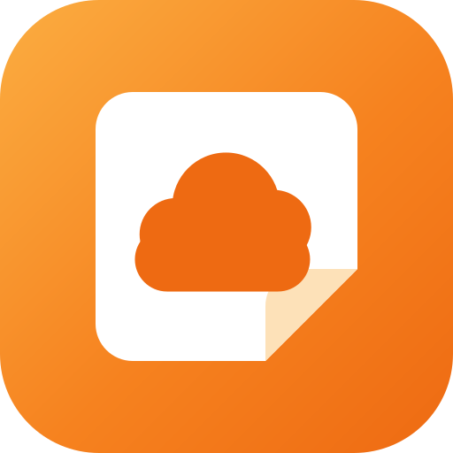
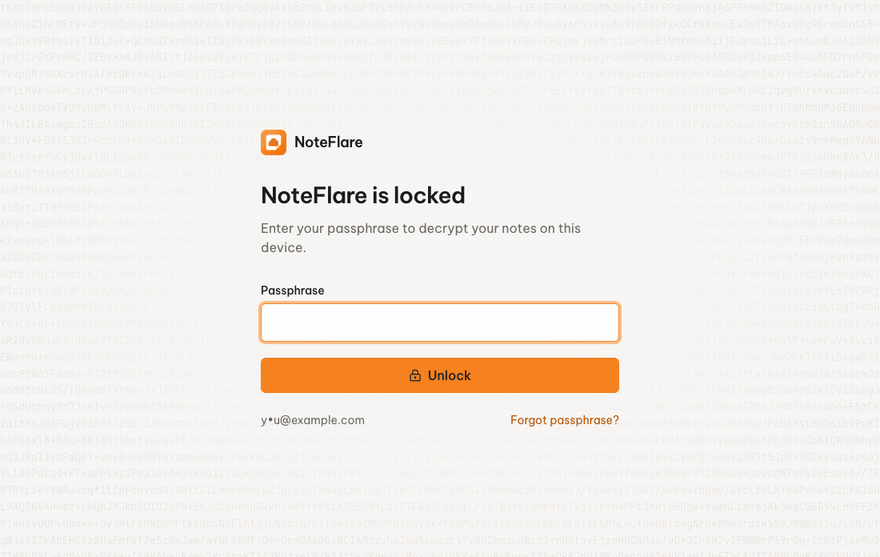
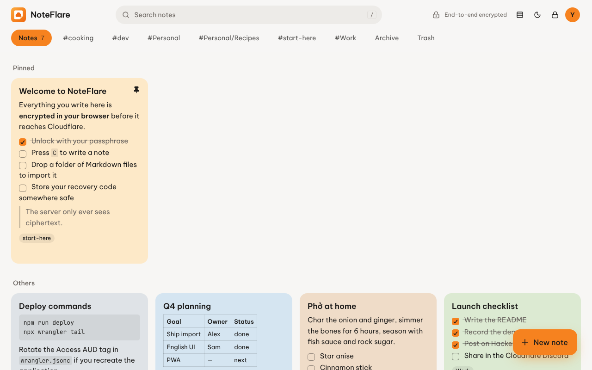
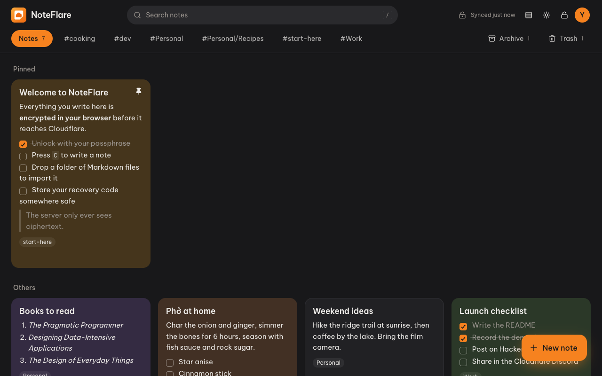
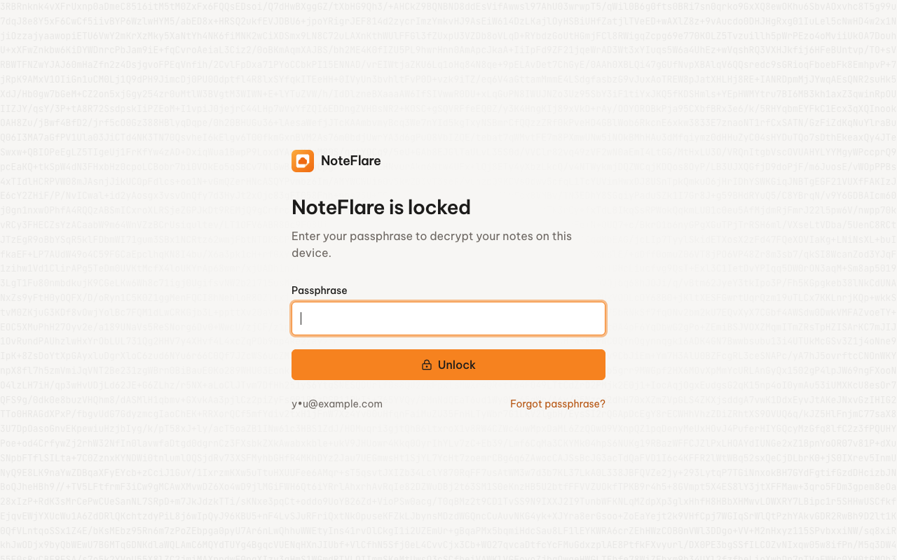
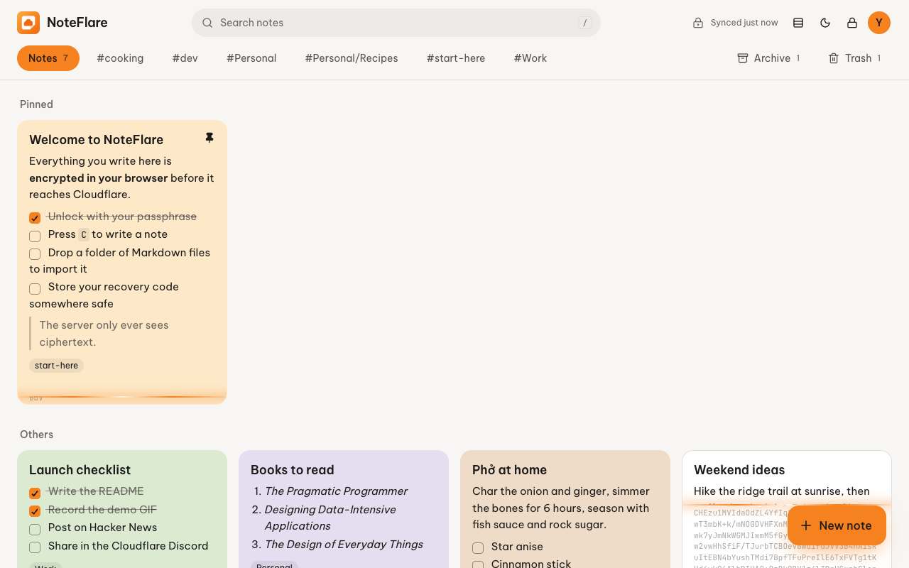
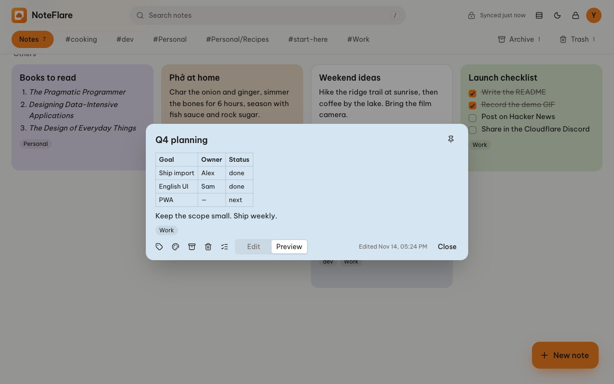
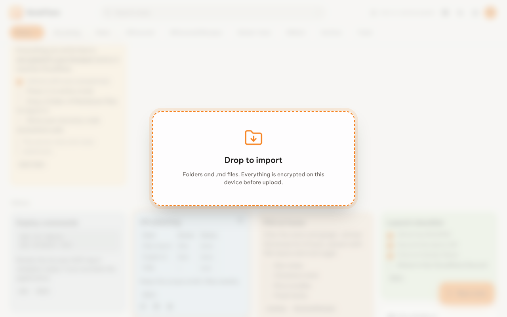
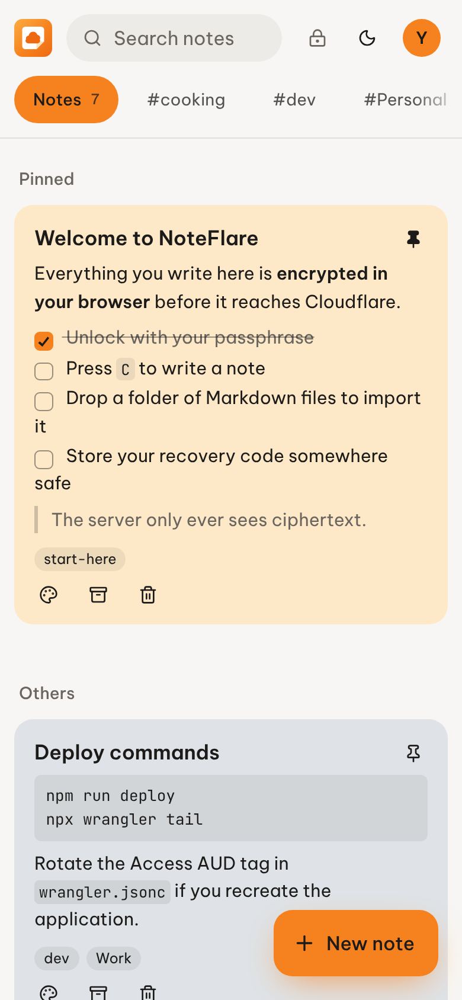
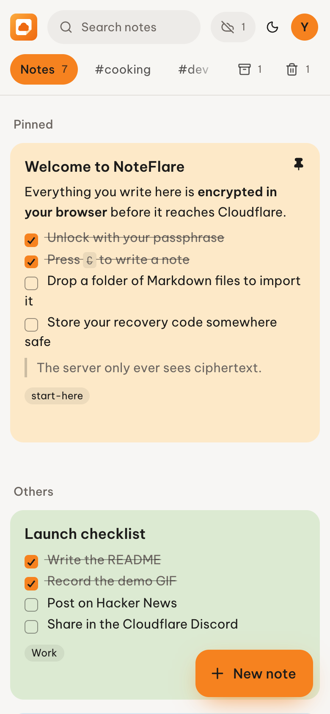

> [!WARNING]
> MẤT **CẢ** PASSPHRASE LẪN MÃ KHÔI PHỤC THÌ GHI CHÚ KHÔNG THỂ KHÔI PHỤC. ĐÓ CHÍNH LÀ Ý NGHĨA CỦA MÃ HOÁ ĐẦU-CUỐI.

<div align="center">



# NoteFlare

**Ghi chú trên Cloudflare, chỉ mình bạn đọc được.**

App ghi chú đơn giản, riêng tư, không cần máy chủ — mã hoá đầu-cuối, chạy miễn phí hoàn toàn, tuỳ biến theo ý bạn.

[Tài liệu](https://noteflare.homielab.com/vi/) · [English](README.md) · [Tiếng Việt](README.vi.md)

[](https://deploy.workers.cloudflare.com/?url=https://github.com/homielab/noteflare)


[](https://ko-fi.com/homielab)



</div>

## ✨ Tính năng

- 🔐 **Mã hoá đầu-cuối**: Argon2id + AES-256-GCM ngay trong trình duyệt. Máy chủ chỉ lưu ciphertext.
- 💸 **Chạy miễn phí hoàn toàn**: một Worker, một database D1, Cloudflare Access — tất cả trên gói Free.
- 🎨 **Tuỳ biến theo ý bạn**: React, Tailwind, shadcn/ui thuần; một API Hono nhỏ và các file migration SQL thuần.
- 📝 **Ghi chú markdown**: tiêu đề, bảng, trích dẫn, code có tô màu cú pháp, checklist `- [ ]` tick ngay trên thẻ.
- 📌 **Sắp xếp theo cách của bạn**: ghim, kéo ghi chú theo thứ tự bạn muốn, 8 màu giấy, nhãn, lưu trữ, thùng rác tự dọn sau 30 ngày. Chọn nhiều ghi chú, hoặc tất cả, rồi gắn nhãn hoặc chuyển vào thùng rác một lần; đổi tên hoặc xóa nhãn ở mọi ghi chú, hoặc tạo bản sao của một ghi chú.
- 📥 **Kéo thả để nhập**: thả một thư mục Markdown (vault Obsidian cũng được), bản xuất Google Keep (kèm hình ảnh) hoặc bản xuất Evernote, Simplenote, Standard Notes, mọi ghi chú được mã hoá khi nhập.
- 📤 **Xuất và sao lưu**: tải ghi chú về dạng Markdown, hoặc một bản sao lưu đã mã hoá để khôi phục sau này.
- 🖼️ **Ảnh và file mã hoá** (tuỳ chọn): đính kèm ảnh, PDF hay bất kỳ file nào, được mã hoá trước khi tải lên và lưu trong bucket R2 của riêng bạn. Xem mọi ảnh trong một thư viện, kèm tab File cho các file còn lại.
- ✨ **Mở khoá là giải mã tại chỗ**: từng ghi chú hiện ra từ ciphertext ngay khi bạn mở khoá.
- 📱 **Cài như app, dùng được khi offline**: thêm NoteFlare vào màn hình chính. Đọc, viết, mở khoá không cần mạng; có mạng lại thì tự đồng bộ.
- 🔀 **Đồng bộ nhiều thiết bị thông minh**: hai máy cùng sửa một ghi chú thì được gộp theo từng dòng, giống `git merge`. Chỉ khi sửa cùng một dòng khác nhau mới tách thành bản riêng.
- ⚡ **Cập nhật tức thì**: sửa trên một thiết bị, các thiết bị khác đang mở thấy ngay, không cần tải lại.
- 🗝️ **Mã khôi phục**: quên passphrase vẫn không mất ghi chú; đổi passphrase không cần mã hoá lại.
- 👆 **Mở khoá bằng passkey**: Face ID, Touch ID, Windows Hello hoặc khoá bảo mật thay cho gõ passphrase, vẫn mã hoá đầu-cuối.
- 🔗 **Chia sẻ ghi chú bằng liên kết**: gửi một bản chỉ đọc của một ghi chú, mở được mà không cần đăng nhập. Bản này được mã hoá bằng khoá chỉ nằm trong liên kết, nên máy chủ không đọc được. Liên kết có thể hết hạn sau 1, 7 hoặc 30 ngày, và bạn thu hồi được bất cứ lúc nào.
- 🔒 **Tự khoá**: khoá bị xoá khỏi bộ nhớ sau 15 phút không thao tác, hoặc chỉ với một cú nhấp.
- ✍️ **Trình soạn Markdown biết giúp bạn**: danh sách và checklist tự nối dòng khi nhấn Enter, Tab để thụt lề, một chạm để biến các dòng thành checklist.
- 🌗 **Sáng/tối, dạng lưới hoặc danh sách, dùng tốt trên điện thoại**, phím tắt (nhấn `?` để xem), tôn trọng chế độ giảm chuyển động.
- 🔄 **Thông báo cập nhật và ghi chú phát hành ngay trong app**, do chính Worker của bạn kiểm tra, không theo dõi.
- 🌐 **Sáu ngôn ngữ có sẵn** — English, Español, Français, Deutsch, Português (Brasil), Tiếng Việt — lần đầu tự theo ngôn ngữ trình duyệt của bạn; thêm ngôn ngữ chỉ cần một file.
- 🔌 **Tự xây client riêng**: token truy cập, API `/api/v1` ổn định có spec OpenAPI, SDK TypeScript lo phần mã hoá, và CLI.

> [!TIP]
> **NoteFlare dành cho ai?** Cho người muốn sự đơn giản của Google Keep mà không phải giao ghi chú cho ai —
> kể cả máy chủ đang chạy app. Phù hợp với cá nhân và nhóm nhỏ (Cloudflare Access miễn phí tới 50 người).

## 🪧 Ảnh chụp

<table>
  <tr>
    <td width="50%"></td>
    <td width="50%"></td>
  </tr>
  <tr>
    <td></td>
    <td></td>
  </tr>
  <tr>
    <td></td>
    <td></td>
  </tr>
</table>

<p align="center">
  
  &nbsp;
  
</p>

## 🚀 Bắt đầu

Bạn cần một tài khoản Cloudflare và một tài khoản GitHub, đều miễn phí. Không cần biết lập trình, mất khoảng 10 phút.

1. **[Triển khai bằng một cú nhấp](https://noteflare.homielab.com/vi/start/deploy/)**: bấm **Deploy to Cloudflare** ở trên, nhập email của bạn và chờ build xong.
2. **[Cài đặt đăng nhập](https://noteflare.homielab.com/vi/start/access/)**: mở link NoteFlare mới của bạn và dán một API token Cloudflare dùng một lần. NoteFlare tự thêm lớp đăng nhập Cloudflare Access để chỉ email của bạn mở được.
3. **[Tạo passphrase](https://noteflare.homielab.com/vi/start/first-run/)**: passphrase dùng để mã hoá ghi chú. Hãy ghi lại mã khôi phục.

Muốn xem trước từng bước: [video 3 phút có thuyết minh](https://noteflare.homielab.com/vi/start/deploy/).

Thích dùng terminal, hoặc muốn nhờ AI agent làm giúp? Xem [Triển khai bằng dòng lệnh](https://noteflare.homielab.com/vi/start/command-line/):

```bash
bun install
bunx wrangler login
bun run deploy   # build → deploy Worker (tạo D1) → chạy migration
```

Cập nhật về sau chỉ cần một cú nhấp: [Cập nhật phiên bản mới](https://noteflare.homielab.com/vi/start/update/). Gặp lỗi? Xem [Câu hỏi thường gặp](https://noteflare.homielab.com/vi/reference/faq/).

## 📖 Hướng dẫn

Mọi hướng dẫn nằm trong **[tài liệu NoteFlare](https://noteflare.homielab.com/vi/)** (tiếng Việt và tiếng Anh).

| Hướng dẫn | Nội dung |
| --- | --- |
| [Nhập ghi chú](https://noteflare.homielab.com/vi/guides/import/) | Thư mục Markdown, vault Obsidian, Google Keep, Evernote, Simplenote, Standard Notes |
| [Xuất và sao lưu](https://noteflare.homielab.com/vi/guides/export-backup/) | Xuất Markdown, sao lưu đã mã hoá, sao lưu hằng ngày, khôi phục |
| [Ảnh và file](https://noteflare.homielab.com/vi/guides/images/) | Bật đính kèm mã hoá trong bucket R2 của riêng bạn |
| [Chia sẻ ghi chú bằng liên kết](https://noteflare.homielab.com/vi/guides/share/) | Liên kết chỉ đọc, có hạn dùng, khoá chỉ nằm trong liên kết |
| [Cài lên điện thoại, dùng offline](https://noteflare.homielab.com/vi/guides/install-offline/) | Cài app, những gì dùng được khi offline, mẹo dùng Access trên điện thoại |
| [Đồng bộ giữa các thiết bị](https://noteflare.homielab.com/vi/guides/sync/) | Cách gộp chỉnh sửa từ hai thiết bị |
| [Tích hợp và API](https://noteflare.homielab.com/vi/guides/integrations/) | Token truy cập, SDK TypeScript, CLI, MCP server cho công cụ AI |
| [Tuỳ biến](https://noteflare.homielab.com/vi/guides/customize/) | Sửa file nào để đổi màu, ngôn ngữ, thời gian và hơn thế |
| [Hạn mức miễn phí](https://noteflare.homielab.com/vi/reference/free-tier/) | Cách NoteFlare nằm gọn trong gói Free của Cloudflare |
| [Checklist bảo mật](https://noteflare.homielab.com/vi/reference/hardening/) | Siết chặt bản triển khai của bạn |

## 🔐 Mã hoá hoạt động thế nào

```
passphrase    ──Argon2id (64 MiB, t=3)──► KEK  ──AES-GCM wrap──► wrappedDek   ┐
mã khôi phục  ──HKDF-SHA256─────────────► RKEK ──AES-GCM wrap──► recoveryDek  ├─ lưu trong D1
PRF passkey   ──HKDF-SHA256─────────────► PKEK ──AES-GCM wrap──► bản của passkey │  (mỗi passkey một bản)
DEK ngẫu nhiên 256-bit ──AES-GCM, AAD = "note:<id>"──► ciphertext của note    ┘
                       ──AES-GCM, AAD = "blob:<id>"──► ciphertext của file đính kèm (R2, tuỳ chọn)
```

- Passphrase, khoá dữ liệu (DEK) và nội dung ghi chú không bao giờ rời trình duyệt ở dạng rõ. Tiêu đề, nội dung, nhãn và màu đều nằm trong ciphertext.
- Trong phiên làm việc, DEK là `CryptoKey` non-extractable, chỉ nằm trong RAM. Khoá app là xoá nó đi.
- Worker tự kiểm tra JWT của Cloudflare Access thay vì tin header, và client từ chối tham số Argon2 yếu, nên máy chủ xấu không hạ cấp KDF được.

Chi tiết: [Mã hoá](https://noteflare.homielab.com/vi/concepts/encryption/) và [Kiến trúc](https://noteflare.homielab.com/vi/concepts/architecture/).

## 🧱 Công nghệ

Cloudflare Workers (Static Assets, Cron Trigger, Durable Objects) · D1 · R2 (tuỳ chọn) · Cloudflare Access + jose · Hono · React 19 · Tailwind CSS 4 · shadcn/ui · View Transitions API · TanStack Markdown + TanStack Highlight · WebCrypto + hash-wasm · Service Worker + IndexedDB (idb)

## 🚗 Lộ trình

Rất hoan nghênh đóng góp. Đọc [CONTRIBUTING.md](CONTRIBUTING.md), và mở issue để bàn trước những thay đổi lớn.

- [x] Mã hoá đầu-cuối kèm mã khôi phục
- [x] Markdown với checklist tick được
- [x] Nhãn, ghim, lưu trữ, thùng rác tự dọn
- [x] Mở khoá giải mã tại chỗ và View Transitions
- [x] Giao diện tiếng Anh, Tây Ban Nha, Pháp, Đức, Bồ Đào Nha (Brasil) và tiếng Việt
- [x] Kéo thả để nhập Markdown
- [x] Cài như app, dùng được khi offline
- [x] Tự động gộp 3 chiều giữa các thiết bị
- [x] API công khai, token truy cập, SDK TypeScript và CLI
- [x] Xuất từ web app, sao lưu đã mã hoá và khôi phục
- [x] Kéo thả sắp xếp
- [x] Đính kèm ảnh và file mã hoá trên R2
- [x] Nhập từ Google Keep, Evernote, Simplenote và Standard Notes
- [x] Tô màu code bằng TanStack Highlight
- [x] Mở khoá bằng passkey và chia sẻ bằng liên kết

## 🙋 Hỏi đáp

**Cloudflare có đọc được ghi chú không?** Không. Ghi chú được mã hoá trong trình duyệt trước khi gửi đi; D1 chỉ chứa ciphertext và khoá đã bọc.

**Có thật sự miễn phí?** Có, trên gói Free của Cloudflare. Không có dịch vụ trả phí nào trong hệ thống. Xem [hạn mức miễn phí](https://noteflare.homielab.com/vi/reference/free-tier/).

**Có app điện thoại không?** NoteFlare cài từ trình duyệt như một app và dùng được khi offline. Không có bản trên App Store.

**Quên passphrase thì sao?** Bấm **Quên passphrase?** ở màn hình khoá và nhập mã khôi phục. Mất cả hai thì không ai giải mã được, đó là thiết kế.

Thêm câu trả lời, gồm cả cách xử lý lỗi khi cài đặt, trong [trang Hỏi đáp](https://noteflare.homielab.com/vi/reference/faq/).

## 📚 Tài liệu

| Tài liệu | Dành cho |
| --- | --- |
| [Tài liệu NoteFlare](https://noteflare.homielab.com/vi/) | Triển khai, sử dụng, cập nhật và tuỳ biến NoteFlare |
| [Hướng dẫn API](docs/API.md) | Viết script và ứng dụng dùng `/api/v1`, SDK và CLI (tiếng Anh) |
| [Kiến trúc](docs/ARCHITECTURE.md) | Worker, D1, mã hoá và đồng bộ offline phối hợp ra sao (tiếng Anh) |
| [Bảo mật](SECURITY.md) | Mô hình đe doạ, máy chủ thấy được gì, cách báo lỗ hổng (tiếng Anh) |
| [Đóng góp](CONTRIBUTING.md) | Cài đặt môi trường, chạy test, checklist khi gửi pull request (tiếng Anh) |
| [Nhật ký thay đổi](CHANGELOG.md) | Thay đổi qua từng phiên bản (tiếng Anh) |

## 📄 Giấy phép

[MIT](LICENSE). NoteFlare là dự án độc lập, không liên kết với Cloudflare hay Google. Bảng màu cam là lời chào tới nền tảng mà nó chạy trên đó; logo là thiết kế riêng, không dùng nhãn hiệu của Cloudflare.

## ⭐ Ủng hộ

NoteFlare miễn phí, không quảng cáo, không theo dõi, và sẽ luôn như vậy. Nếu nó giữ ghi chú của bạn an toàn:

- **Gắn sao cho repo** để người khác tìm thấy dự án.
- **[Mời mình một ly cà phê trên Ko-fi](https://ko-fi.com/homielab)** để có thêm thời gian phát triển.
- **Cho mình biết bạn đã triển khai** trong [Discussions](https://github.com/homielab/noteflare/discussions). Không có telemetry nên đó là cách duy nhất để biết nó chạy tốt.

[](https://ko-fi.com/homielab)
