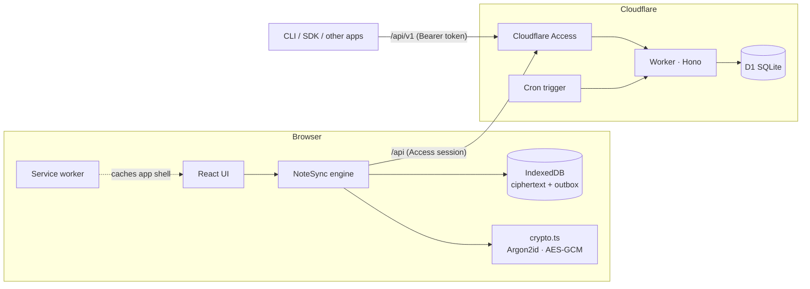

# Architecture

NoteFlare is one Cloudflare Worker that serves a React app and a small JSON API, with a D1 database behind it. All the interesting work happens in the browser: encryption, decryption, offline storage, sync and merging. The server stores and returns opaque blobs.

## Repository map

| Path | What it is |
| --- | --- |
| `worker/index.ts` | The Worker: API routes, auth middleware, static assets, daily trash purge |
| `worker/auth.ts` | Verifies the Cloudflare Access JWT (signature, issuer, audience) |
| `worker/tokens.ts` | Personal access tokens: generate, hash, verify |
| `worker/openapi.ts` | OpenAPI 3.1 description served at `/api/v1/openapi.json` |
| `worker/updates.ts` | Checks GitHub for a newer release (cached, can be turned off) |
| `shared/release.ts` | Version comparison and changelog parsing, shared by the Worker, the app and the release scripts |
| `scripts/` | `release.mjs` cuts a version; `release-notes.mjs` prints one version's notes; `update-from-upstream.sh` updates a deployed copy, keeping its settings |
| `migrations/` | D1 schema, applied in order by Wrangler |
| `packages/client/` | `@noteflare/client`: wire types, crypto, three-way merge and the SDK. The web app imports the same code |
| `packages/cli/` | `noteflare` command-line tool built on the SDK |
| `shared/types.ts` | Re-exports the wire types for the app and the Worker |
| `src/lib/vault.tsx` | Vault state: set up, unlock, lock, recovery, change passphrase |
| `src/lib/sync/` | Offline-first sync: `engine.ts` (NoteSync), `localStore.ts` (IndexedDB), `merge.ts` |
| `src/lib/notes.ts` | React hook that connects the UI to NoteSync |
| `src/lib/importMarkdown.ts`, `importKeep.ts` | Turn dropped folders and files (Markdown, Google Keep exports) into notes |
| `src/lib/exportNotes.ts`, `zip.ts` | Markdown export, encrypted backup and restore |
| `src/lib/attachments.tsx` | Encrypted image attachments: upload, decrypt, render |
| `src/lib/highlight.ts` | Languages bundled for code highlighting |
| `src/lib/reorder.ts` | Positions for drag-and-drop ordering |
| `src/sw/sw.js` | Service worker; the Vite plugin in `vite.config.ts` fills in its precache list |
| `src/components/` | UI, built on shadcn/ui and Tailwind |
| `src/i18n/` | English (source of truth) and Vietnamese messages |
| `tests/` | Vitest suites for crypto, auth, sync, merge, import and tokens |

## Data model

D1 holds three tables.

- **`vaults`**, one row per user: Argon2id salt and parameters, the data key wrapped by the passphrase key, and the data key wrapped by the recovery key.
- **`notes`**, keyed by user and note id: `ciphertext` and `iv`, plus the plaintext fields the server needs to sort and filter (`pinned`, `archived`, `trashed_at`, `position`), a `version` counter and timestamps.
- **`api_tokens`**: token name, scope, prefix, SHA-256 hash, expiry and last use. The token itself is never stored.

Inside a note's ciphertext is JSON: `{ title, body, color, labels }`. See [SECURITY.md](../SECURITY.md) for exactly what is and isn't visible to the server.

## Keys

1. On first visit the browser creates a random 256-bit data key (DEK) and a recovery code.
2. The passphrase goes through Argon2id to make a key-encryption key; the recovery code goes through HKDF. Each wraps the DEK with AES-GCM.
3. Only the wrapped DEKs, the salt and the parameters are uploaded.
4. Unlocking reverses step 2 and imports the DEK as a non-extractable `CryptoKey`. Locking drops it.

Changing the passphrase re-wraps the DEK; notes aren't touched.

## Requests and auth

The same API is mounted twice:

- **`/api`** is for the web app. The caller must have a Cloudflare Access session. It can do everything, including changing the vault and managing tokens.
- **`/api/v1`** is for everything else. It accepts only `Authorization: Bearer nf_…` tokens, never cookies, and allows any origin (CORS `*`). Tokens can't change the vault or manage tokens.

POST requests must be `application/json`, which blocks simple cross-site form posts. Every API response is `Cache-Control: no-store`.

In production Cloudflare Access sits in front of the whole Worker. For `/api/v1` you either add a Bypass policy (the token is then the only gate) or use Access service tokens; the README covers both.

## Sync

The web app is offline-first. The UI reads and writes IndexedDB; NoteSync moves changes between IndexedDB and the server in the background.

**Saving.** Edits are encrypted and written to IndexedDB at once, then debounced for 700 ms and put in an outbox. The outbox is pushed with optimistic concurrency: each `PUT` carries the `baseVersion` it was edited from. The server answers `409` with the current note if someone else got there first.

**Conflicts.** On a 409 the engine runs a three-way merge between the version it started from, its own version and the server's:

- Text is merged line by line. If both sides changed the same lines, the server's version wins and the local version is saved as a separate "conflict copy" note.
- Labels are merged as sets. For pin, archive and color, the local change wins.

**Pulling.** The engine asks for notes changed since the last pull (with a 2-second overlap for clock skew) and reconciles deletions against `/notes/index`.

**Retrying.** Failed pushes retry every 5 seconds and when the tab becomes visible again. Nothing is lost while offline: the outbox lives in IndexedDB.

The SDK's `save()` uses the same merge, so a script and the web app can edit one note safely.

## Offline app shell

The service worker precaches the built app, including the code-split notebook chunk and the Argon2id library, which the lock screen preloads while you type. Page navigations go network-first (with navigation preload) so an expired Access session can still redirect to login; when the network is down, slow, or the server answers with an error, the cached shell loads and unlocks against the vault stored in IndexedDB.

A new deploy changes the precache hash. The new worker installs in the background and **waits**: the app shows "A new version is ready", and only when the user taps Reload does it send `SKIP_WAITING` and reload. A page therefore never runs against another version's assets.

The manifest declares a `share_target` (GET, so shares pass through Cloudflare Access like any page), `file_handlers` for `.md` files and `launch_handler: focus-existing`. `src/lib/launch.ts` turns URL parameters and `launchQueue` launches into actions that wait until the notebook is unlocked.

## Scheduled work

A daily cron trigger deletes notes that have been in the trash for more than 30 days.

## Versions and updates

- The version lives in `package.json`; `shared/version.ts` imports it into both the Worker and the app.
- `GET /api/version` returns this version and the latest GitHub release of `UPDATE_CHECK_REPO` (default `homielab/noteflare`, `"off"` to disable). Only the Worker contacts GitHub, with no user data, cached for 6 hours in memory and Cloudflare's cache. `?refresh=1` skips the cache at most once a minute.
- `CHANGELOG.md` is bundled into the app (`src/lib/updates.ts`) and parsed by `shared/release.ts`, which the release scripts share. After an update, the app compares the version with the one this browser last ran and offers the new release notes.
- `bun run release` cuts a version from the changelog; the Release workflow publishes the tag as a GitHub release.

## Design choices

- **Cloudflare-only on purpose.** Workers, D1 and Access give a free, zero-maintenance deployment with login built in. The cost is portability; the API, SDK and Markdown export are there so data never gets stuck.
- **No server-side search.** The server can't read notes, so search runs in the browser over decrypted notes.
- **One codebase for crypto.** The web app, SDK and CLI share `packages/client`, so there is one implementation to review.
- **No telemetry.** Nothing about you or your notes ever leaves your deployment. The only outbound request is the Worker's release check, which you can turn off.
