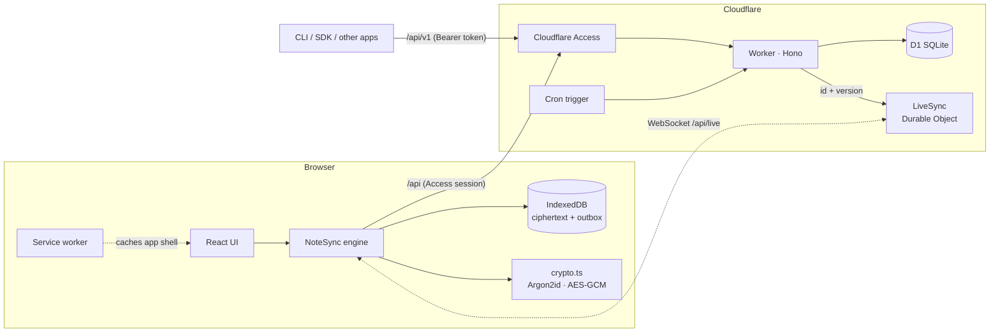

# Architecture

NoteFlare is one Cloudflare Worker that serves a React app and a small JSON API, with a D1 database behind it. All the interesting work happens in the browser: encryption, decryption, offline storage, sync and merging. The server stores and returns opaque blobs.

## Repository map

| Path | What it is |
| --- | --- |
| `worker/index.ts` | The Worker: API routes, auth middleware, static assets, daily trash purge |
| `worker/auth.ts` | Verifies the Cloudflare Access JWT (signature, issuer, audience) |
| `worker/setup.ts` | First-run setup: creates the Access login with the owner's API token and keeps its settings in D1 |
| `worker/tokens.ts` | Personal access tokens: generate, hash, verify |
| `worker/openapi.ts` | OpenAPI 3.1 description served at `/api/v1/openapi.json` |
| `worker/live.ts`, `worker/liveObject.ts` | Live sync: `notifyLive` builds the message, `LiveSync` is the Durable Object that holds a user's WebSockets |
| `worker/updates.ts` | Checks GitHub for a newer release (cached, can be turned off) |
| `shared/release.ts` | Version comparison and changelog parsing, shared by the Worker, the app and the release scripts |
| `scripts/` | `release.mjs` cuts a version; `release-notes.mjs` prints one version's notes; `update-from-upstream.sh` updates a deployed copy, keeping its settings |
| `migrations/` | D1 schema, applied in order by Wrangler |
| `packages/client/` | `@noteflare/client`: wire types, crypto, three-way merge and the SDK. The web app imports the same code |
| `packages/cli/` | `noteflare` command-line tool built on the SDK |
| `shared/types.ts` | Re-exports the wire types for the app and the Worker |
| `src/lib/vault.tsx` | Vault state: set up, unlock, lock, recovery, change passphrase |
| `src/lib/sync/` | Offline-first sync: `engine.ts` (NoteSync), `localStore.ts` (IndexedDB), `merge.ts`, `live.ts` (WebSocket to `/api/live`) |
| `src/lib/notes.ts` | React hook that connects the UI to NoteSync |
| `src/lib/importMarkdown.ts`, `importKeep.ts`, `importEvernote.ts`, `importSimplenote.ts`, `importStandardNotes.ts` | Turn dropped folders and files (Markdown, Google Keep, Evernote, Simplenote, Standard Notes exports) into notes |
| `src/lib/exportNotes.ts`, `zip.ts` | Markdown export, encrypted backup and restore |
| `src/lib/attachments.tsx` | Encrypted attachments (images and files): upload with progress, decrypt, render, download. Image links may end with `#w=<width>&h=<height>&t=<thumbnail id>`: the size reserves the box before the image loads, `t` names the image's thumbnail. A failed load says why (offline, deleted, storage off, can't decrypt, network) |
| `src/lib/blobCache.ts` | Attachment ciphertext kept on the device (IndexedDB): thumbnails always, full images up to 200 MB, least recently used out first |
| `src/components/ImagePlaceholder.tsx` | The box shown for an image that is loading, uploading or failed |
| `src/lib/highlight.ts` | Languages bundled for code highlighting |
| `src/lib/reorder.ts` | Positions for drag-and-drop ordering |
| `src/sw/sw.js` | Service worker; the Vite plugin in `vite.config.ts` fills in its precache list |
| `src/components/` | UI, built on shadcn/ui and Tailwind |
| `src/i18n/` | English (source of truth), Vietnamese, Spanish, French, German and Portuguese (Brazil) messages |
| `tests/` | Vitest suites for crypto, auth, sync, merge, import and tokens |

## Data model

D1 holds the data in these tables (plus `settings` for the app's own setup).

- **`vaults`**, one row per user: Argon2id salt and parameters, the data key wrapped by the passphrase key, and the data key wrapped by the recovery key.
- **`notes`**, keyed by user and note id: `ciphertext` and `iv`, plus the plaintext fields the server needs to sort and filter (`pinned`, `archived`, `trashed_at`, `position`), a `version` counter and timestamps.
- **`passkeys`**: per user, the credential id, a name, the PRF salt and one more wrapped copy of the data key.
- **`shares`**: read-only links to one note. Per link: a random id, the note id, the snapshot's `ciphertext` and `iv`, an expiry and a timestamp. The snapshot is `{ title, body }` encrypted with AES-256-GCM under a fresh key per link (additional data `share:<id>`); the key exists only in the link's `#fragment`.
- **`api_tokens`**: token name, scope, prefix, SHA-256 hash, expiry and last use. The token itself is never stored.

Inside a note's ciphertext is JSON: `{ title, body, color, labels }`, plus `importedCreatedAt` / `importedUpdatedAt` for imported notes (their original dates; the row's `updated_at` stays the server's clock, because it is the sync cursor). See [SECURITY.md](../SECURITY.md) for exactly what is and isn't visible to the server.

## Keys

1. On first visit the browser creates a random 256-bit data key (DEK) and a recovery code.
2. The passphrase goes through Argon2id to make a key-encryption key; the recovery code goes through HKDF. Each wraps the DEK with AES-GCM.
3. Only the wrapped DEKs, the salt and the parameters are uploaded.
4. Unlocking reverses step 2 and imports the DEK as a non-extractable `CryptoKey`. Locking drops it.

Changing the passphrase re-wraps the DEK; notes aren't touched.

A passkey adds one more wrap (`src/lib/passkeys.ts`): after the passphrase unlocks an extractable DEK, the browser creates a passkey with the WebAuthn PRF extension, derives a key from its PRF output with HKDF, wraps the DEK and saves it with `POST /api/passkeys`. `GET /api/vault` returns the passkeys with the vault, so the device copy unlocks offline too. `DELETE /api/passkeys/:id` removes one. Both are session-only and not part of `/api/v1`'s public contract.

## Requests and auth

The same API is mounted twice:

- **`/api`** is for the web app. The caller must have a Cloudflare Access session. It can do everything, including changing the vault and managing tokens.
- **`/api/v1`** is for everything else. It accepts only `Authorization: Bearer nf_…` tokens, never cookies, and allows any origin (CORS `*`). Tokens can't change the vault or manage tokens.

POST requests must be `application/json`, which blocks simple cross-site form posts. Every API response is `Cache-Control: no-store`.

Shared links are the only public routes: `GET /s/<id>` serves a self-contained page (inline script and style under a nonce CSP, no app code) that fetches `GET /api/share/<id>` and decrypts it with the key from the fragment. The web app manages links through `/api/shares` (session only). A link stops working when revoked, expired, or when its note is trashed or deleted.

In production Cloudflare Access sits in front of the whole Worker. For `/api/v1` you either add a Bypass policy (the token is then the only gate) or use Access service tokens; the [API guide](API.md) covers both.

## Sync

The web app is offline-first. The UI reads and writes IndexedDB; NoteSync moves changes between IndexedDB and the server in the background.

**Saving.** Edits are encrypted and written to IndexedDB at once, then debounced for 700 ms and put in an outbox. The outbox is pushed with optimistic concurrency: each `PUT` carries the `baseVersion` it was edited from. The server answers `409` with the current note if someone else got there first.

**Conflicts.** On a 409 the engine runs a three-way merge between the version it started from, its own version and the server's:

- Text is merged line by line. If both sides changed the same lines, the server's version wins and the local version is saved as a separate "conflict copy" note.
- Labels are merged as sets. For pin, archive and color, the local change wins.

**Pulling.** The engine asks for notes changed since the last pull (with a 2-second overlap for clock skew) and reconciles deletions against `/notes/index`.

**Live updates.** The app opens a WebSocket to `/api/live` (session only, same origin only). It is served by `LiveSync`, a Durable Object with one instance per user, so a socket only hears about its owner's notes. After each successful write the Worker sends `{ id, version }` pairs (version 0 = deleted), never content or titles; the app then runs a normal pull. If the socket is down or the `LIVE` binding is missing, polling and the visibility check still sync.

**Retrying.** Failed pushes retry every 5 seconds and when the tab becomes visible again. Nothing is lost while offline: the outbox lives in IndexedDB.

The SDK's `save()` uses the same merge, so a script and the web app can edit one note safely.

## Images: thumbnails and the device cache

Uploading an image larger than 400 px also makes a small version in the browser (longest side 400 px, WebP, or JPEG where the browser can't write WebP; not for animated GIFs). It is encrypted like any attachment, under an id of its own, and uploaded as a second blob. The image's link names it in its fragment: ``. The fragment never reaches the server, so the server holds one more opaque blob and nothing that ties it to an image or a note. `gridSource()` and `loadGridImage()` give a grid the thumbnail, or the full image when a link has none (images uploaded before thumbnails existed, or by the SDK) or the thumbnail is gone. A thumbnail that can't be made or stored never fails the upload: the link is written without `t`.

A thumbnail lives and dies with its image. Deleting a note forever, or emptying the trash, deletes every blob no remaining note refers to, thumbnails included (`unusedAttachments()`). Exports and backups carry the full image only.

Every blob the app downloads or uploads is also kept on the device, as the same ciphertext the server holds, in the `noteflare-blobs` IndexedDB database (`src/lib/blobCache.ts`); nothing decrypted is written. A blob is cached only after it decrypted. An image seen once therefore shows offline and is not downloaded again, and "Offline, not on this device" means exactly that. Thumbnails are always kept; full images share a 200 MB cap and the least recently used go first. Deleting an attachment removes it from the cache, and signing out deletes the cache. Locking leaves it: it is ciphertext. The service worker has no part in this and never touches `/api`.

## Offline app shell

The service worker precaches the built app, including the code-split notebook chunk and the Argon2id library, which the lock screen preloads while you type. Page navigations go network-first (with navigation preload) so an expired Access session can still redirect to login; when the network is down, slow, or the server answers with an error, the cached shell loads and unlocks against the vault stored in IndexedDB.

A new deploy changes the precache hash. The new worker installs in the background and **waits**: the app shows "A new version is ready", and only when the user taps Reload does it send `SKIP_WAITING` and reload. A page therefore never runs against another version's assets.

The manifest declares a `share_target` (GET, so shares pass through Cloudflare Access like any page), `file_handlers` for `.md` files and `launch_handler: focus-existing`. `src/lib/launch.ts` turns URL parameters and `launchQueue` launches into actions that wait until the notebook is unlocked.

## Scheduled work

A daily cron trigger deletes notes that have been in the trash for more than 30 days. With the `ATTACHMENTS` R2 binding, it then writes each user's encrypted backup (`worker/backups.ts`, the same file the app exports) to `backups/<email>/<date>.json` and keeps the newest 14. It also deletes expired shared links and links whose note no longer exists.

## Versions and updates

- The version lives in `package.json`; `shared/version.ts` imports it into both the Worker and the app.
- `GET /api/version` returns this version and the latest GitHub release of `UPDATE_CHECK_REPO` (default `homielab/noteflare`, `"off"` to disable). Only the Worker contacts GitHub, with no user data, cached for 6 hours in memory and Cloudflare's cache. `?refresh=1` skips the cache at most once a minute.
- `CHANGELOG.md` is bundled into the app (`src/lib/updates.ts`) and parsed by `shared/release.ts`, which the release scripts share. After an update, the app compares the version with the one this browser last ran and offers the new release notes.
- "Update now": with the secrets `GITHUB_UPDATE_TOKEN` and `GITHUB_UPDATE_REPO`, `GET /api/version` reports `canUpdate` to web-app sessions and `POST /api/update` (session only) asks GitHub to run `.github/workflows/update.yml` on the repository's default branch (`worker/updates.ts`). The token never leaves the Worker.
- `bun run release` cuts a version from the changelog; the Release workflow publishes the tag as a GitHub release.

## Design choices

- **Cloudflare-only on purpose.** Workers, D1 and Access give a free, zero-maintenance deployment with login built in. The cost is portability; the API, SDK and Markdown export are there so data never gets stuck.
- **No server-side search.** The server can't read notes, so search runs in the browser over decrypted notes.
- **One codebase for crypto.** The web app, SDK and CLI share `packages/client`, so there is one implementation to review.
- **No telemetry.** Nothing about you or your notes ever leaves your deployment. The only outbound request is the Worker's release check, which you can turn off.
